# 夜秣漫画生成器

> 把小说章节，一键转成传统漫画多格分镜页 —— 从提示词到成品页，全流程。

   


**夜秣漫画生成器**是一个跑在 [WorkBuddy](https://www.workbuddy.cn) 里的 AI 漫画生产技能。丢给它一段小说章节，它产出**一整页传统漫画分镜**——每一页是一张完整漫画图，内含 2~5 个分格，整体构图、色调、光影、画风高度统一。

v2.0 起有两条交付路线：

- **模式 A · 提示词**：出可直接复制的英文生图提示词，丢进 Midjourney / Niji / 任意文生图工具
- **模式 B · 成品页**：先让模型出**不带字**的干净画面，中文对话由脚本叠上去 —— **零错字，改台词不用重画**

---

## 🌟 我们的核心优势

别人给你「一格图的提示词」，夜秣给你「一整页能看的漫画」。别人翻车的地方，是我们的主场：

| 做 AI 漫画的塌方点 | 夜秣漫画生成器怎么接住 |
|---|---|
| 同一页里人物忽高忽矮、衣服变色 | **一致性锚定清单**：色调 / 光源 / 背景 / 服装 / 画风逐页写死，所有分格共用同一基底 |
| 整本漫画一个版式摊到底，像 PPT | **7 骨架 + 68 版式**：从 68 种专业分镜里逐页调度，页页有变化 |
| 68 种版式太多，根本不会选 | **5 个节奏档位**：你只做 5 选 1，AI 在幕后从 68 种里智能编排 |
| 心理戏只会冒文字气泡，干巴巴 | **角色双版模式（v1.2）**：内心独白用二头身 Q 版小人演出来，更有看头 |
| 长篇节奏越画越平，高潮不突出 | **防版式疲劳硬约束**：连续两页不撞版式、燃系整册 ≤15%、花样不连用 |
| 画风就那几样，换风格得重寫提示词 | **274 种手绘风格库**：说一个 #编号 即换画风（A–H 八组，从都市涂鸦到国风水墨） |
| 模型画中文必错，错一个字整页废 | **图字分离（v2.0）**：画面不带字，中文气泡由脚本组版，笔画 100% 正确，改台词秒级重排 |
| 改了台词要重新生图，脸跟着变 | **组版不碰画（v2.0）**：字和画分开两层，改字零成本，人物一致性不受伤 |
| 气泡压脸、尾巴穿人、读者读乱顺序 | **读序硬规则（v2.0）**：脚本自动校验压脸 / 尾巴穿物 / 跳读风险，越界当场报警 |
| 手崩、动作前倒、道具凭空消失 | **动作三时态（v2.0）**：每格强制写前一瞬 / 这一瞬 / 后一瞬，加左右手与道具持有对账 |
| 出图后不知道算不算好 | **八项质检卡（v2.0）**：人体 / 接触 / 物件 / 脸 / 线条 / 背景 / 连续性 / 文字，逐项写观察，禁止全填 pass |
| 提示词和成图对不上，改完不知道改哪 | **左右对照看板（v2.0）**：单文件 HTML，左边提示词右边成图，翻页对照，双击换图 |

> 一句话：**不是帮你"写一条提示词"，而是替你把整本小说"漫画化"。**

---

## 🆕 v2.0：从「会写提示词」到「能出成品」

v1.2 解决了「怎么画得好看」，v2.0 补的是另一半——**怎么画完不崩**。

### 1. 图字分离：让模型画画，让代码写字

图像模型不是在"打字"，它是在"画出看起来像字的图形"。所以中文必错：多一横、少一点、把「姝」画成「妹」。

**改法：把画和字拆开。**

```
第一步  生图提示词写死：No text, no speech bubbles, no lettering, no borders.
        画面里只留一块白色禁区给气泡。

第二步  python scripts/lettering.py --page 图.png --spec 气泡.json --out 成品.png
```

换来四件事：

| | 字在画里 | 图字分离 |
|---|---|---|
| 错字 | 常有，且难发现 | **零** |
| 改台词 | 重新生图（贵、脸会变） | **秒级重排** |
| 气泡位置 | 无法校验 | **脚本可算、可报警** |
| 分层编辑 | 做不到 | 图一层、字一层 |

组版引擎会自动处理：中文换行 + 避头尾、字号自适应、椭圆/爆炸形内接空间补偿、尾巴停在脸外 4px、超长尾巴截断、尾巴不穿人穿物、跳读风险检测。

### 2. 左右对照看板：提示词和成图摆在一起看

```
python scripts/build_board.py --data 第01章.json --out 第01章-对照台.html
```

产出一个**单文件、零依赖、双击即开**的 HTML：

- 左边：场景妆造 / 版式 / 角色模式 / 一致性锚定 / 逐格描述 / 整页生图提示词（带一键复制）
- 右边：这一页的成图，双击可换
- 底部：缩略图导航，`←` `→` 翻页
- 图片三种给法：存成 `images/p01.png`、直接拖进去、批量选择
- 支持打印，一页一版

### 3. 一致性硬档：把「像不像」变成可勾的东西

| 机制 | 解决什么 |
|---|---|
| **脸三特征**（眼皮 / 眉形 / 下颌，不含发型） | 换个角度、换个风，脸还是他 |
| **参考图角色声明**（`Image 1: identity. 只取五官，忽略姿势`） | 多图输入时模型乱抄姿势、抄标注线 |
| **动作三时态**（前一瞬 / 这一瞬 / 后一瞬 + 左右手 + 道具持有对账） | 手崩、动作前倒、道具瞬移 |
| **场次分层**（角色恒常 / 场次状态 / 单格覆盖） | 回想带错衣服、换场带错道具 |

### 4. 八项质检卡 + 两段式盲读

**盲读**：先关掉编号当读者读一遍记下预测顺序，再对照设计意图。顺序不能反——先看答案，眼睛会自动把图脑补成对的。

**八项**：`anatomy` `contact` `objects` `faces` `linework` `background` `continuity` `lettering`，每项必须写针对这张图的具体观察。三条禁令：不许全填 pass、不许用 na 逃检、不许把 fail 改写成 pass。

**三振出局**：同一格同一构图修 3 次不解决，停手，退回去改格数 / 镜头 / 台词量。修到第 3 次还不行，问题不在画上。

### 5. 十步流程

```
1 问节奏 → 2 拆页 → 3 定骨架 → 4 定版式 → 5 立锚
→ 6 填空 → 7 裸读自查 → 8 出提示词 → 9 质检 → 10 出成品
```

第 7 步不许省。

---

## 📐 多少种排版？一眼看清

这是本技能最强的地基——**双层版式体系**，数量明明白白：

### 第一层：7 种基础页面骨架（决定「几格、大块怎么分」）

| 骨架 | 一句话说明 | 适合 |
|---|---|---|
| 竖排多格 | 2~5 格自上而下等宽排列 | 对话、心理戏、追逐快节奏 |
| 左右两格 | 二分屏，两格等高 | 双人对话、对比、同时发生 |
| 上二下一 | 上两格 + 下横跨大格 | 上铺细节、下揭全貌 |
| 上一下二 | 上横跨大格 + 下两格 | 上定调、下特写 |
| 四格网格 | 2×2 传统四宫格 | 起承转合、节奏均衡 |
| L 型布局 | 一侧大格 + 多小格 | 关键大画面 + 后续反应 |
| 上二下二 + 通栏 | 上二、中通栏、下二的 5 格 | 需中间全景过渡的复杂叙事 |

### 第二层：68 种专业分镜版式（决定「格子怎么切、视线怎么走」）

68 种全部归入 **6 个功能族**，覆盖你能想到的所有镜头语言：

| 功能族 | 数量 | 关键词 | 什么时候用 |
|---|---|---|---|
| **A 稳** | 12 种 | 规则网格、四格起承转合、Z/S/螺旋阅读 | 日常、对白，读者一眼看懂 |
| **B 燃** | 12 种 | 对角切割、破框、碎片、放射、满版冲击 | 高潮、冲突、追逐、爆发 |
| **C 情绪** | 12 种 | 超窄反应格、眼神链、由远到近、骤停 | 心理戏、暧昧、沉默、转折 |
| **D 时间** | 10 种 | 跨格人物、一镜到底、胶片式、时钟 | 同一空间内时间推进 |
| **E 花样** | 12 种 | 闪回嵌套、手机聊天式、监控屏、无边框 | 回忆、现代社交、章节点睛 |
| **F 结构** | 10 种 | 双线并行、镜面、窗口、几何分割 | 双线叙事、物件视角、形式感 |

> 编号 SB-001 ~ SB-068 全部覆盖，无缺号、无重复。完整清单与每格英文提示词在 `references/分镜版式库.md`。

### 用户只做 5 选 1：节奏档位

68 种不直接扔给你选（会懵），而是凝练成 **5 个节奏档位**，开工前问你一句：

1. **自动编排（推荐）**——AI 按每页剧情节奏自己调度，整册有起伏
2. **稳**——叙事清晰优先，规则网格 / 四格起承转合为主
3. **燃**——动感冲击优先，对角切割 / 破框 / 满版大格为主
4. **情绪**——留白与特写优先，超窄反应格 / 眼神链 / 骤停为主
5. **花样**——形式感优先，闪回嵌套 / 手机聊天式 / 无边框为主

**合计：7 骨架 + 68 版式 + 5 档位**，这就是本技能的排版家底。

---

## 🎭 角色双版模式（正式版 + 独白Q版）—— v1.2 灵魂升级

漫画里最难的不是打斗，是**心理戏**。纯文字气泡又干又出戏。所以我们给每个主要角色做了**两套演绎形态**，AI 按场景自动切换：

| 形态 | 长相 | 什么时候出场 |
|---|---|---|
| **正式版** | 常规漫画比例（约 6~7 头身），精细五官、完整服装、真实光影 | 所有正常叙事格、对白、动作、场景 |
| **独白Q版** | 二头身 chibi（大头小身），**同款发色发型、同款服装配色、同款标志物**，表情夸张外化 | 内心独白、心理活动、吐槽、脑补幻想、情绪外化（害羞 / 生气 / 崩溃） |

**为什么要有 Q 版？** 借鉴角色定稿图的「角落 Q 版」手法——在画面一角或单独反应格里，放一个同款服装的二头身小人，用夸张动作把内心戏演出来（抱头崩溃 / 脸红冒蒸汽 / 星星眼 / 泪奔）。读者一眼就懂角色在想什么，比纯文字有看头得多。

**三种插入方式，按场景挑：**
1. **角落 Q 版插图**——正式版主格的画面一角（左下 / 右下）附一个二头身小人正在做夸张反应，适合对白格里的内心吐槽。
2. **独立 Q 版反应格**——单独开一个小格，整格都是 Q 版小人在演绎情绪（如「苏念一 Q 版：抱头，头顶冒蒸汽，配字『他怎么又出现了！』」），适合情绪高潮。
3. **想象嵌套式**——在 E 花样族的「想象嵌套」里，现实格保持正式版，嵌套小窗里用 Q 版演脑补画面。

> 独白Q版属于「情绪外化」手段，优先放在 **C 情绪族**（超窄反应格 / 眼神链 / 骤停）与 **E 花样族**（闪回嵌套 / 想象嵌套）的页面里；纯动作页（B 燃族）一般不用。

---

## 🎨 274 种手绘风格库（任选画风）—— v1.2 灵魂升级

除了排版和双版角色，本技能还内置一份 **274 种手绘 / IP 风格编号画廊**（A–H 八大组）。开工前你只要说一个「#编号」或「风格名 / 参考作者」，AI 就把整页画风换成那一种——从神经质都市涂鸦到国风水墨、从萌系插画到复古绘本，全都能画。

### 八大组速览

| 组 | 调性 | 数量 |
|---|---|---|
| A | 西式讽刺 / 社论 / 概念手绘 | 35 |
| B | 怪趣童话 / 梦境绘本 | 19 |
| C | 朋克 / 怪诞 / 负空间图形 | 28 |
| D | 东亚墨线 / 生活速写 / 时尚日记 | 41 |
| E | 国潮 / 古风 / 电影感 / 诗意都市 | 31 |
| F | 日系脱线 / 粗糙 zine / 双色孔版 | 46 |
| G | 国内插画师 · 萌系 / 治愈 / 国风 | 16 |
| H | 风格化 3D 卡通 / 复古绘本 | 58 |

### 八大组风格样图（AI 生成示例，对应下面对应分组）

| 组A | 组B | 组C | 组D |
|---|---|---|---|
| 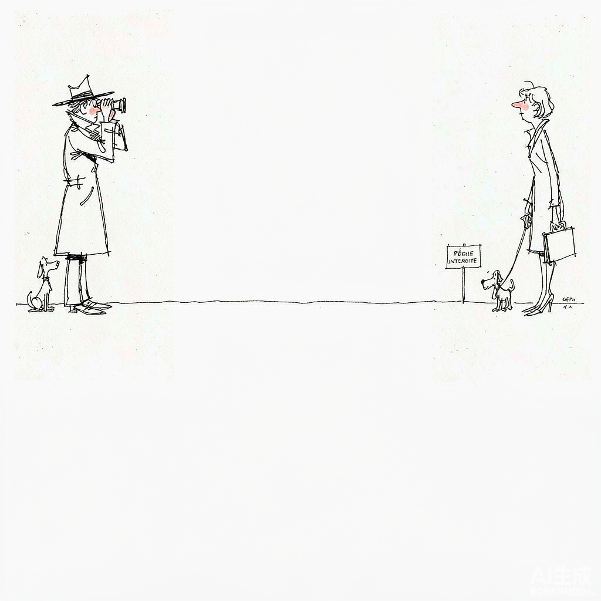 | 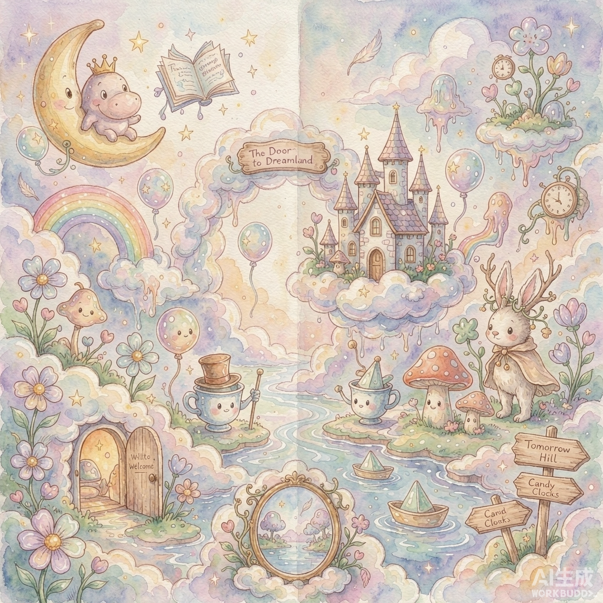 | 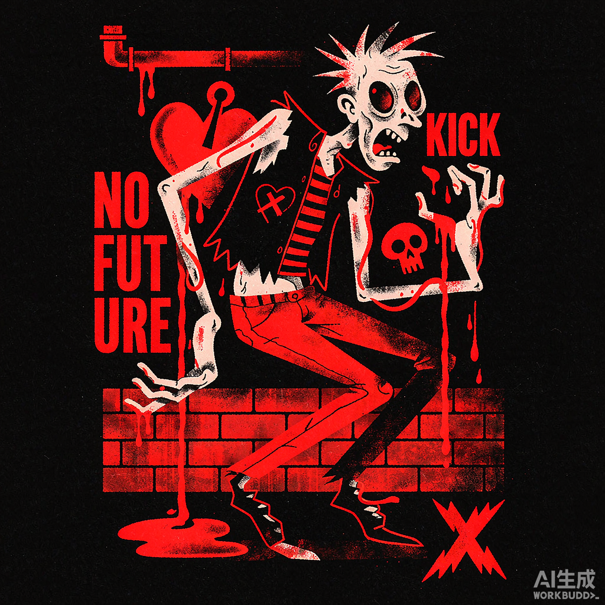 | 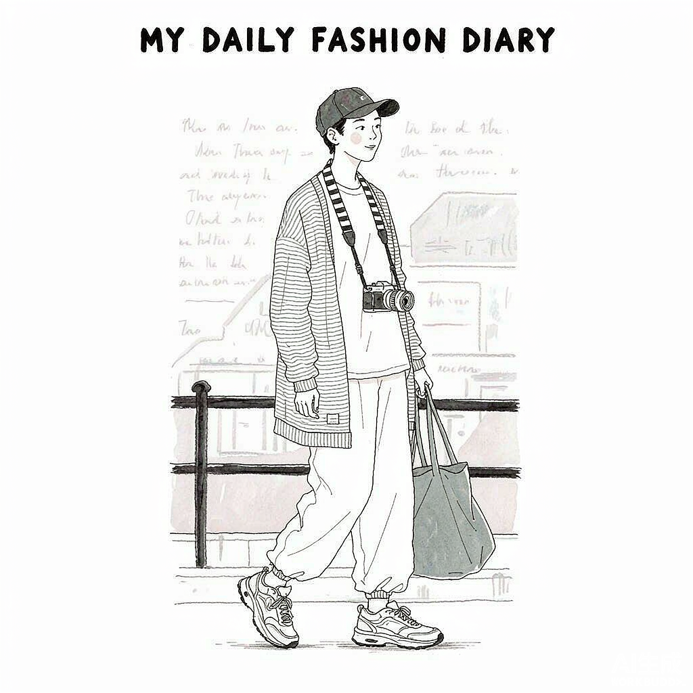 |
| 组E | 组F | 组G | 组H |
|---|---|---|---|
| 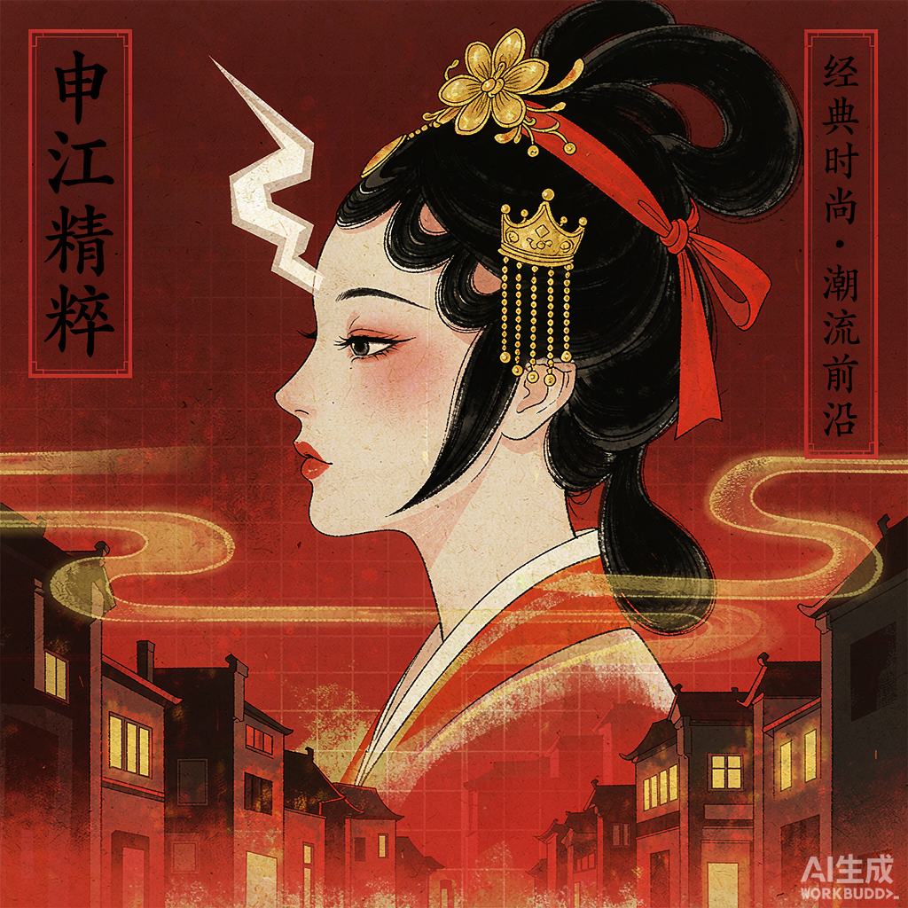 | 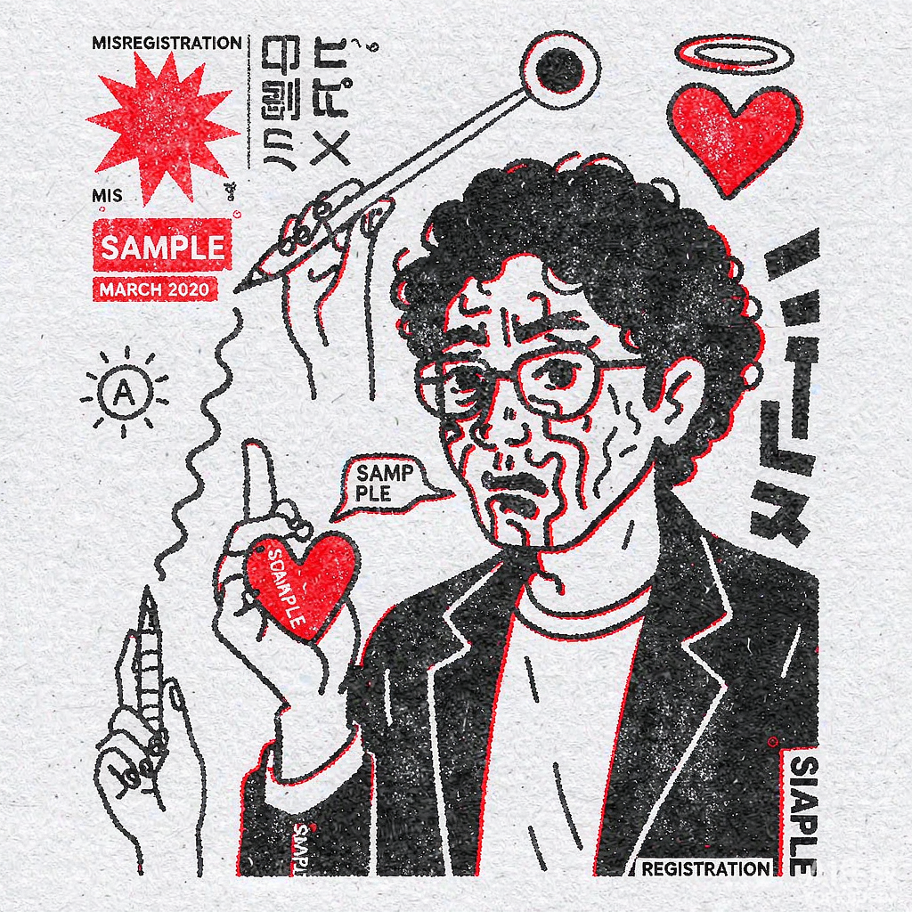 | 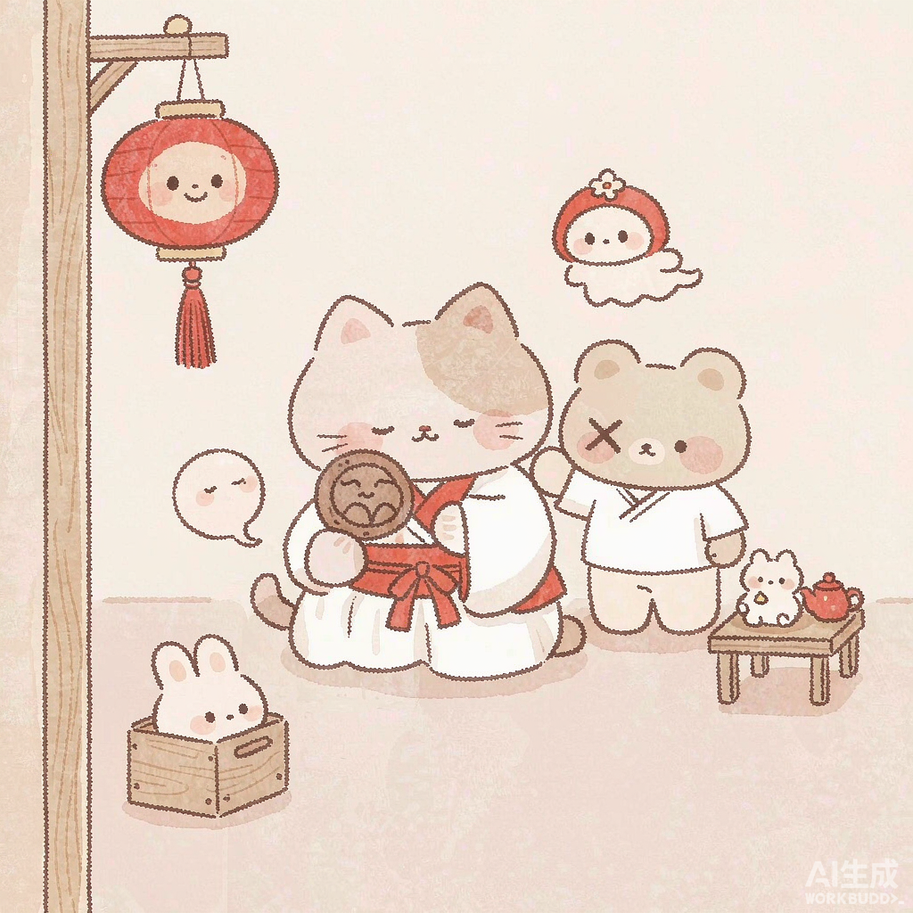 | 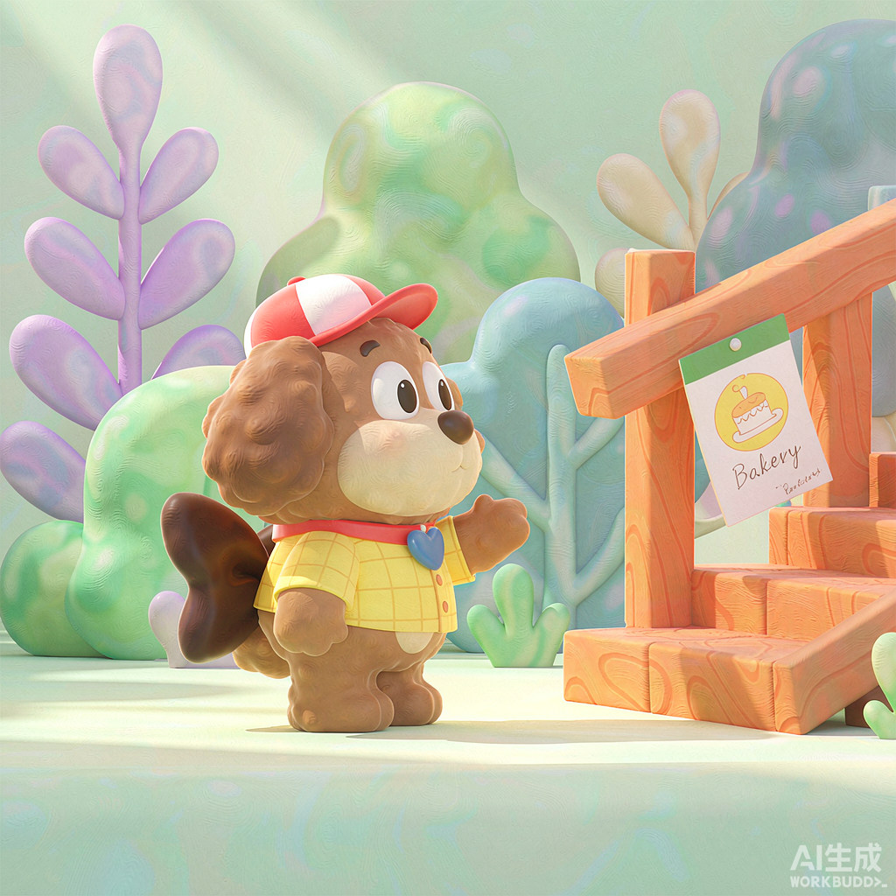 |


### 完整 274 种风格清单（A–H 全量，说 #编号 即换画风）

#### 组 A · 西式讽刺 / 社论 / 概念手绘（35 种）

| 编号 | 风格名 | 参考作者 | 风格说明 |
|---|---|---|---|
| #001 | Playful Deadpan Doodle | Gemma Correll | 松散黑线、怪萌人物、少量点色、白底、日常吐槽与尴尬幽默；人物轮廓优先于细节堆砌，脸型、头身比例与手脚形状要形成清楚而独立的视觉语言；表情偏冷脸、尴尬或突然夸张，姿态要有明确喜剧节奏，避免统一的可爱微笑。 |
| #002 | Conceptual Continuous-Line Editorial | Saul Steinberg | 极简线描、连续线、概念隐喻、人与空间一体化、智性幽默。 |
| #003 | Fine-Line Urban Miniature | Jean-Jacques Sempé | 极细钢笔线、小人物大空间、大量留白、温柔法式都市幽默。 |
| #004 | Awkward Minimal Ink Cartoon | James Thurber | 故意笨拙的极简线条、比例失衡、几笔成形、冷幽默。 |
| #005 | Childlike Free-Line Humor | Shel Silverstein | 极简黑线、儿童式自由造型、荒诞动作、低细节。 |
| #006 | Victorian Crosshatch Gothic Cartoon | Edward Gorey | 黑白钢笔、密集排线、维多利亚气息、古怪冷峻黑色幽默。 |
| #007 | Frenetic Scratch-Ink Caricature | Ronald Searle | 狂躁钢笔、断裂墨线、细长人体、尖锐夸张、动态极强。 |
| #008 | Nervous Urban Notebook Cartoon | Roz Chast | 神经质手绘、歪斜线条、手写文字、都市焦虑式喜剧；人物轮廓优先于细节堆砌，脸型、头身比例与手脚形状要形成清楚而独立的视觉语言；表情与肢体动作要服从该风格的人格机制，避免回落为统一的标准Q版表情。 |
| #009 | Raw Zine Diary Cartoon | Lynda Barry | 粗糙手帐、Zine 感、手写字、原始情绪、反精致；人物轮廓优先于细节堆砌，脸型、头身比例与手脚形状要形成清楚而独立的视觉语言；保留纸纹、颗粒、套印或手工媒介的不完美，强化独立出版物的触感。 |
| #010 | Geometric Literary Deadpan | Tom Gauld | 极小几何人物、极简场景、文学/科技梗、冷面幽默；脸部与服装主动做减法，依靠清楚轮廓、眼口和少量关键形状建立人物辨识度；表情偏冷脸、尴尬或突然夸张，姿态要有明确喜剧节奏，避免统一的可爱微笑。 |
| #011 | Deliberately Bad Absurd Doodle | David Shrigley | 故意画坏、粗糙黑线、幼稚造型、荒诞文字、强 meme 感；人物轮廓优先于细节堆砌，脸型、头身比例与手脚形状要形成清楚而独立的视觉语言；表情偏冷脸、尴尬或突然夸张，姿态要有明确喜剧节奏，避免统一的可爱微笑。 |
| #012 | Minimal Visual-Pun Editorial | Christoph Niemann | 极简概念设计、物体重解释、视觉双关、脑洞型构图；脸部与服装主动做减法，依靠清楚轮廓、眼口和少量关键形状建立人物辨识度；表情与肢体动作要服从该风格的人格机制，避免回落为统一的标准Q版表情。 |
| #013 | Bold Flat Everyday Satire | Jean Jullien | 粗黑轮廓、扁平色块、现代人物、互联网生活讽刺；以醒目外轮廓和大形组织人物，五官少而有力，动作通过肩胯与手脚方向直接传达；表情偏冷脸、尴尬或突然夸张，姿态要有明确喜剧节奏，避免统一的可爱微笑。 |
| #014 | Handwritten British Anti-Inspiration Cartoon | Mr Bingo | 随手钢笔、手写字、恶趣味、英式反鸡汤幽默；保留明显手绘笔压、停顿与轻微不齐整感，让轮廓产生真实纸上绘制的节奏；表情偏冷脸、尴尬或突然夸张，姿态要有明确喜剧节奏，避免统一的可爱微笑。 |
| #015 | Soft Relationship Editorial Line Art | Brian Rea | 极简人物线稿、人与关系、柔和色块、生活型社论；脸部与服装主动做减法，依靠清楚轮廓、眼口和少量关键形状建立人物辨识度；配色控制在柔和低刺激色域，用少量点色区分层次，背景保持轻和干净。 |
| #016 | Raw Emotional Internet Doodle | Rubyetc | 粗糙黑线、极简人体、心理情绪、自嘲式互联网漫画；脸部与服装主动做减法，依靠清楚轮廓、眼口和少量关键形状建立人物辨识度；保留纸纹、颗粒、套印或手工媒介的不完美，强化独立出版物的触感。 |
| #017 | Black-and-White Reaction Diary Cartoon | Sarah Andersen | 黑白简线、圆眼反应表情、松散黑发、日常衣着；人物常与小动物或生活物件并置，依靠简单轮廓和大面积留白塑造轻松的生活漫画感。 |
| #018 | Minimal Deadpan Dialogue Cartoon | Poorly Drawn Lines / Reza Farazmand | 极简圆头人物、面无表情、简单动物、灰蓝与米色小色块；人物和动物以干净轮廓置于白底中，靠冷淡姿态和微小关系制造荒诞幽默。 |
| #019 | Explosive Webcomic Exaggeration | The Oatmeal / Matthew Inman | 粗黑线、夸张圆眼、张大嘴、头发和四肢大幅甩动；人物常与动物同框，以强烈动作、巨大表情和少量灰黑色块形成爆发式网络漫画效果。 |
| #020 | Low-Fi Frenzy Cartoon | Allie Brosh | 粗糙鼠绘感、黑色乱发、极端大眼大嘴、粉色大色块、单人失控动作；保留低保真数字涂画的不规整轮廓和直接粗粝的互联网幽默。 |
| #021 | Watercolor Handwritten Life Notes | Mari Andrew | 极简女性人物、细黑线、细长四肢、柔和水彩点染；以红色心形等单一物件承载生活情绪，画面保持白底、留白和轻微纸张质感。 |
| #022 | Flat Everyday Women Lifestyle | Sally Nixon | 日常女性人物、蓬松手绘线稿、低饱和外套与围巾、旁边的小鸟；姿态自然站立，服装和动物用清楚色块区分，整体保留生活速写的轻松感。 |
| #023 | Warm Minimal Female Line Cartoon | Agathe Sorlet | 黑色简线、黑色长发女性、坐姿、白上衣与蓝色牛仔裤；以少量暖色腮红和红色鞋带点亮画面，背景保持干净，气质亲密而松弛。 |
| #024 | Geometric Fashion Deadpan | Jean-Michel Tixier | 夸张大头、松散黑色短线、冷面人物、横条纹上衣、灰黑与浅色块；人物比例故意不协调，依靠简化脸部和粗略纹理形成时尚而疏离的幽默感。 |
| #025 | One-Panel Absurd Social Cartoon | Gary Larson | 单格漫画、极简黑线、细长人物与动物并置、荒诞社会情境；人物和动物以克制的姿态和少量灰绿色块呈现一本正经的反逻辑幽默。 |
| #026 | Dense Silent Physical Comedy | Sergio Aragonés | 密集小动物和小人物、粗黑线、夸张鼻子与张嘴大笑、四肢向外伸展；画面充满无字肢体喜剧和拥挤的动作信息。 |
| #027 | Underground Crosshatched Grotesque Cartoon | R. Crumb | 黑色密排线、粗重轮廓、坐姿人物、夸张而不修饰的人体比例；皮肤、头发和衣物依靠密集交叉排线塑造，带有地下漫画的粗粝与怪诞。 |
| #028 | Retro Detached American Comic | Daniel Clowes | 黑色齐肩直发、方形眼镜、条纹上衣与绿色外套、冷静平涂色块；人物正面站立、表情疏离，画面具有复古美式成人漫画的克制感。 |
| #029 | Geometric Diagrammatic Narrative | Chris Ware | 几何精密线条、孤立小人物、公交站牌与城市方块、信息图式留白；人物和环境由规整矩形与细线组成，色彩克制，叙事像一张安静的城市图表。 |
| #030 | Clean Urban Solitude Comic | Adrian Tomine | 清晰细线、年轻亚洲女性半身像、深色外套、低饱和肤色与黑发；人物侧身回望，表情安静克制，背景留白，呈现都市观察和轻微疏离。 |
| #031 | High-Contrast Black-White Memoir Cartoon | Marjane Satrapi | 黑白高对比、粗黑剪影、盘坐女性、简化五官、大片纯黑服装；人物姿态直接而静止，依靠白色脸部和黑色轮廓形成克制的回忆录漫画感。 |
| #032 | Loose French Improvised Ink | Joann Sfar | 松散法式墨线、蓬乱卷发、大眼女性、黑猫、随意坐姿；线条保留手绘停顿和轻微不齐整，配合少量暖色块，形成即兴、俏皮而略带怪诞的画面。 |
| #033 | Minimal Newspaper Comic | Charles M. Schulz | 极简报纸漫画线、圆头小人物、低动作高人格、细微表情。 |
| #034 | Elastic Sunday Strip | Bill Watterson | 松散弹性墨线、夸张儿童表情、强肢体动作、少量透明水彩；保留明显手绘笔压、停顿与轻微不齐整感，让轮廓产生真实纸上绘制的节奏；上色保留透明叠染、柔软边缘和纸纹，允许轻微颜色不均与留白。 |
| #035 | Bold Pop Satire Cartoon | Matt Groening | 粗黑轮廓、圆凸大眼、扁平人物、极少阴影、成人讽刺；以醒目外轮廓和大形组织人物，五官少而有力，动作通过肩胯与手脚方向直接传达；配色使用少量高纯度撞色和平涂，让人物剪影和服装保持强图形对比。 |

#### 组 B · 怪趣童话 / 梦境绘本（19 种）

| 编号 | 风格名 | 参考作者 | 风格说明 |
|---|---|---|---|
| #036 | Loose Ink-and-Wash Storybook | Quentin Blake | 抖动墨线、松散水彩、四肢夸张、动作极灵、快速速写感。 |
| #037 | Nordic Fine-Line Whimsy | Tove Jansson | 北欧墨线、细密但轻盈、奇异人物、温柔孤独、大留白。 |
| #038 | Busy Anthropomorphic Everyday World | Richard Scarry | 拟人动物社会、职业角色、圆润轮廓、丰富生活动作。 |
| #039 | Warm Vintage Line-and-Wash | Arnold Lobel | 古典细线、水彩旧书感、安静角色、温暖生活气息。 |
| #040 | Crosshatched Wild Storybook | Maurice Sendak | 细线排线、怪物造型、童话荒诞、毛茸茸纹理。 |
| #041 | Bendy Absurd Storybook | Dr. Seuss | 极端比例、弯曲结构、怪生物、流动线条、疯狂想象。 |
| #042 | Naturalist Watercolor Animal Storybook | Beatrix Potter | 精细水彩、自然主义动物、古典绘本、柔和纸张感。 |
| #043 | Classic Pen-and-Light-Wash Storybook | E. H. Shepard | 钢笔速写、淡水彩、古典角色、优雅而轻松。 |
| #044 | Quirky Ink-and-Watercolor Tale | Satoshi Kitamura | 怪趣人物、墨线、水彩、不规则比例、现代童话；保留明显手绘笔压、停顿与轻微不齐整感，让轮廓产生真实纸上绘制的节奏；上色保留透明叠染、柔软边缘和纸纹，允许轻微颜色不均与留白。 |
| #045 | Minimal Poetic Picturebook Doodle | Oliver Jeffers | 极简人物、手写感、松散涂色、诗意荒诞；脸部与服装主动做减法，依靠清楚轮廓、眼口和少量关键形状建立人物辨识度；表情偏冷脸、尴尬或突然夸张，姿态要有明确喜剧节奏，避免统一的可爱微笑。 |
| #046 | Bold Geometric Picturebook | Chris Haughton | 几何块面、极简轮廓、高饱和色、强剪影；脸部与服装主动做减法，依靠清楚轮廓、眼口和少量关键形状建立人物辨识度；配色使用少量高纯度撞色和平涂，让人物剪影和服装保持强图形对比。 |
| #047 | Muted Deadpan Picturebook | Jon Klassen | 极简动物、半闭眼、低饱和、Deadpan 冷幽默；脸部与服装主动做减法，依靠清楚轮廓、眼口和少量关键形状建立人物辨识度；配色控制在柔和低刺激色域，用少量点色区分层次，背景保持轻和干净。 |
| #048 | Folk-Line Decorative Storybook | Carson Ellis | 民俗线描、复古配色、植物纹样、奇异群像；人物轮廓优先于细节堆砌，脸型、头身比例与手脚形状要形成清楚而独立的视觉语言；表情与肢体动作要服从该风格的人格机制，避免回落为统一的标准Q版表情。 |
| #049 | Dreamlike Surreal Storybook | Shaun Tan | 柔和手绘笔触、轻微超现实人物、低饱和梦境配色、安静叙事气质；人物轮廓简洁清楚，比例略诗意变形，表情克制偏沉静，留出白底与空间感，避免过于指向单一作者的独特怪脸机制。 |
| #050 | Layered Vintage Storybook Collage | Lane Smith | 分层拼贴质感、复古纸张肌理、手工剪贴与印刷颗粒感并存；人物由大形与贴纸般色块构成，造型怪趣但易读，配色温暖克制，强调材料感与旧书气息，避免复现某个固定童书角色。 |
| #051 | Expressive Character Sketch Cartoon | Peter de Sève | 速写式手绘线条、夸张但亲切的人物表演、清楚外轮廓与鲜明性格；脸部结构简化，眉眼嘴主导情绪，动作有动画草图般弹性和节奏，适合做高人格角色，避免过度逼近具体作者角色设计。 |
| #052 | Dreamlike Clean-Line Sci-Fi Figure | Jean Giraud / Moebius | 干净细线、轻科技感人物、简洁未来服装与梦境般留白；线条清晰克制，配色偏浅淡蓝灰或柔和中性色，人物修长、姿态安静，强调现代科幻插图气质而非某个具体世界观。 |
| #053 | European Clear-Line Adventure Figure | Hergé | 欧洲清线漫画语言、整洁闭合轮廓、平涂配色、人物可读性极高；造型简洁、动作明确，脸部结构控制在少量特征之内，带轻冒险叙事感，避免直接滑向某个经典固定角色。 |
| #054 | Geometric European Clear-Line Figure | Joost Swarte | 几何化清线人物、现代主义图形秩序、简洁建筑感服装与姿态；以圆方弧线组织角色，平涂色块干净，表情直接而克制，整体更偏欧洲平面设计人物感，避免过强的单一作者指纹。 |

#### 组 C · 朋克 / 怪诞 / 负空间图形（28 种）

| 编号 | 风格名 | 参考作者 | 风格说明 |
|---|---|---|---|
| #055 | Chaotic Color Doodle Crowd | Jon Burgerman | 即兴彩色 Doodle、怪物人物、粗轮廓、高密度快乐混乱；人物轮廓优先于细节堆砌，脸型、头身比例与手脚形状要形成清楚而独立的视觉语言；表情与肢体动作要服从该风格的人格机制，避免回落为统一的标准Q版表情。 |
| #056 | Pop Magazine Doodle Overlay | Hattie Stewart | 卡通嘴眼、杂志涂鸦覆盖、Pop 色彩、朋克恶搞；人物轮廓优先于细节堆砌，脸型、头身比例与手脚形状要形成清楚而独立的视觉语言；配色使用少量高纯度撞色和平涂，让人物剪影和服装保持强图形对比。 |
| #057 | Retro Geometric City Cartoon | Andy Rementer | 几何人物、复古城市、高饱和平涂、70s–80s 商业卡通感；人物以圆、方、弧线等大形构成，五官图标化，比例强调图形辨识而非写实解剖；配色使用少量高纯度撞色和平涂，让人物剪影和服装保持强图形对比。 |
| #058 | Minimal Bold-Color Fashion Geometry | Olimpia Zagnoli | 极简几何、大块高饱和色、女性时尚人物；脸部与服装主动做减法，依靠清楚轮廓、眼口和少量关键形状建立人物辨识度；配色使用少量高纯度撞色和平涂，让人物剪影和服装保持强图形对比。 |
| #059 | High-Contrast Negative-Space Figure | Malika Favre | 极简剪影、正负形、高对比色、强视觉切割；脸部与服装主动做减法，依靠清楚轮廓、眼口和少量关键形状建立人物辨识度；主要依靠黑白关系和大面积留白塑形，表情集中在眼神、眉形与嘴形变化。 |
| #060 | Negative-Space Visual-Pun Graphic | Noma Bar | 负空间、双重图像、极少颜色、视觉双关；人物轮廓优先于细节堆砌，脸型、头身比例与手脚形状要形成清楚而独立的视觉语言；表情与肢体动作要服从该风格的人格机制，避免回落为统一的标准Q版表情。 |
| #061 | Midcentury Geometric Fairytale | Mary Blair | 几何童话、现代主义色块、夸张比例、明快配色。 |
| #062 | Ultra-Geometric Nature Character | Charley Harper | 极端几何化动物与人物、Flat Shape、装饰性强。 |
| #063 | Rough Cut-Paper Modernist Graphic | Saul Bass | 剪纸般粗粝几何形、强符号、极少元素。 |
| #064 | Playful Modernist Collage Character | Paul Rand | 拼贴、玩具式图形、几何人物、现代主义幽默。 |
| #065 | Retro Pop Editorial Figure | Milton Glaser | 复古社论、强轮廓、波普色彩、海报化人物。 |
| #066 | Bold Retro Advertising Cartoon | Seymour Chwast | 粗线、复古广告、怪趣人物、Push Pin 气质。 |
| #067 | Decorative Retro Commercial Illustration | Push Pin Studios | 复古商业插画、装饰线条、怪人物、印刷感。 |
| #068 | Freeform Cut-Paper Figure | Henri Matisse cut-outs | 剪纸色块、自由人体、极简轮廓、大面积纯色。 |
| #069 | Poetic Single-Line Figure | Jean Cocteau line drawing | 单线脸、不断笔、极少细节、优雅诗性。 |
| #070 | Abstract Continuous-Line Figure | Pablo Picasso line drawings | 连续线、抽象人体、几何变形、符号化。 |
| #071 | Bold Kinetic Street-Pictogram | Keith Haring | 粗黑连续轮廓、动态小人、高动作、街头图腾。 |
| #072 | Raw Symbolic Graffiti Figure | Jean-Michel Basquiat | 原始涂鸦、皇冠与符号、文字碎片、爆裂能量。 |
| #073 | Punk Ink-and-Text Editorial | Raymond Pettibon | 黑墨速写、朋克线稿、文字并置、粗粝社论；保留明显手绘笔压、停顿与轻微不齐整感，让轮廓产生真实纸上绘制的节奏；表情与肢体动作要服从该风格的人格机制，避免回落为统一的标准Q版表情。 |
| #074 | Grotesque Classical-Comic Portrait | George Condo drawing | 扭曲五官、怪表情、古典人物与漫画混合；人物轮廓优先于细节堆砌，脸型、头身比例与手脚形状要形成清楚而独立的视觉语言；表情与肢体动作要服从该风格的人格机制，避免回落为统一的标准Q版表情。 |
| #075 | Flat Belle-Époque Poster Figure | Henri de Toulouse-Lautrec | 海报式人物、简化轮廓、平面色块、都市生活。 |
| #076 | Angular Expressive Figure Line | Egon Schiele drawing | 断裂敏感线条、细瘦人体、扭曲姿态、强情绪。 |
| #077 | Raw Art-Brut Figure | Jean Dubuffet | Art Brut、粗糙线、人形符号、儿童式反精致。 |
| #078 | Poetic Geometric Symbol Figure | Paul Klee | 细线几何、童真符号、诗意色块、抽象人物。 |
| #079 | Biomorphic Symbolic Character | Joan Miró | 生物符号、原始线条、红蓝黄点色、自由空间。 |
| #080 | Fluid Single-Line Motion Figure | Alexander Calder drawings | 单线人物、流畅连续线、极简动态。 |
| #081 | Cinematic Grainy Flat-Shape Illustration | Tom Haugomat | 电影感极简色块、颗粒、强光影、远近层次；脸部与服装主动做减法，依靠清楚轮廓、眼口和少量关键形状建立人物辨识度；保留纸纹、颗粒、套印或手工媒介的不完美，强化独立出版物的触感。 |
| #082 | Retro Silkscreen Geometric Figure | Blexbolex | 复古丝网印刷、厚重几何色层、旧书颗粒；人物以圆、方、弧线等大形构成，五官图标化，比例强调图形辨识而非写实解剖；保留纸纹、颗粒、套印或手工媒介的不完美，强化独立出版物的触感。 |

#### 组 D · 东亚墨线 / 生活速写 / 时尚日记（41 种）

| 编号 | 风格名 | 参考作者 | 风格说明 |
|---|---|---|---|
| #083 | Dynamic East-Asian Ink Editorial | Yuko Shimizu | 流动墨线、东方笔意、强动作、现代 Editorial；保留明显手绘笔压、停顿与轻微不齐整感，让轮廓产生真实纸上绘制的节奏；线条带书写性与留白意识，衣褶、发丝和姿势顺势流动，东方感来自形与节奏。 |
| #084 | Quiet Low-Saturation Japanese Editorial | Tatsuro Kiuchi | 安静平面人物、低饱和、留白、日系现代社论；人物轮廓优先于细节堆砌，脸型、头身比例与手脚形状要形成清楚而独立的视觉语言；配色控制在柔和低刺激色域，用少量点色区分层次，背景保持轻和干净。 |
| #085 | Minimal Fashion Line Figure | Yu Nagaba | 极简黑线、时尚人物、无阴影、大白底；脸部与服装主动做减法，依靠清楚轮廓、眼口和少量关键形状建立人物辨识度；人物姿态松弛自然，服装靠清楚剪影体现时尚感，避免模板化甜美脸。 |
| #086 | Cool Minimal Black-and-White Figure | Noritake | 黑白线稿、极简脸、无表情、清冷日常；脸部与服装主动做减法，依靠清楚轮廓、眼口和少量关键形状建立人物辨识度；主要依靠黑白关系和大面积留白塑形，表情集中在眼神、眉形与嘴形变化。 |
| #087 | Showa Retro Commercial Cartoon | Ryohei Yanagihara | 昭和商业插画、圆润人物、明快复古色。 |
| #088 | Airy Transparent Watercolor Figure | Chihiro Iwasaki | 极轻透明水彩、柔和人物、湿边晕染、大量白纸。 |
| #089 | Showa Everyday Family Comic | Machiko Hasegawa | 昭和家庭漫画、简洁线条、日常观察。 |
| #090 | Folklore Monster Ink Cartoon | Shigeru Mizuki | 朴拙漫画线、民俗怪谈、妖怪造型、黑白纹理。 |
| #091 | Classic Rounded Manga Character | Osamu Tezuka | 圆润漫画轮廓、清楚表演、大眼、强动作可读性。 |
| #092 | Rebellious Big-Head Deadpan Figure | Yoshitomo Nara | 大头冷脸、叛逆眼神、极少背景、怪可爱；人物轮廓优先于细节堆砌，脸型、头身比例与手脚形状要形成清楚而独立的视觉语言；表情偏冷脸、尴尬或突然夸张，姿态要有明确喜剧节奏，避免统一的可爱微笑。 |
| #093 | 80s Clean-Line Urban Pop Girl | Hisashi Eguchi | 清线都市少女、80s 时尚、大块留白、Pop 色；人物轮廓优先于细节堆砌，脸型、头身比例与手脚形状要形成清楚而独立的视觉语言；配色使用少量高纯度撞色和平涂，让人物剪影和服装保持强图形对比。 |
| #094 | Ornate Strange Botanical Ink | Yuko Higuchi | 精密钢笔、奇异动植物、古典怪萌、细节密集；保留明显手绘笔压、停顿与轻微不齐整感，让轮廓产生真实纸上绘制的节奏；表情与肢体动作要服从该风格的人格机制，避免回落为统一的标准Q版表情。 |
| #095 | Fashion Diary Sketch Girl | きくちあつこ | 女孩穿搭速写、手绘服装、Instagram 日记感；保留明显手绘笔压、停顿与轻微不齐整感，让轮廓产生真实纸上绘制的节奏；人物姿态松弛自然，服装靠清楚剪影体现时尚感，避免模板化甜美脸。 |
| #096 | Loose Deadpan Everyday Sketch | しまだなな | 脱力人物、松散线条、生活吐槽；人物轮廓优先于细节堆砌，脸型、头身比例与手脚形状要形成清楚而独立的视觉语言；表情偏冷脸、尴尬或突然夸张，姿态要有明确喜剧节奏，避免统一的可爱微笑。 |
| #097 | Yuru-Surreal Minimal Everyday Cartoon | のなか海 | ゆるシュール、极简人物、反逻辑日常；脸部与服装主动做减法，依靠清楚轮廓、眼口和少量关键形状建立人物辨识度；表情与肢体动作要服从该风格的人格机制，避免回落为统一的标准Q版表情。 |
| #098 | Notebook Lifestyle Doodle | tomatomayu | 手帐式小人物、小物罗列、文字注记、生活记录；人物轮廓优先于细节堆砌，脸型、头身比例与手脚形状要形成清楚而独立的视觉语言；表情与肢体动作要服从该风格的人格机制，避免回落为统一的标准Q版表情。 |
| #099 | Cute Essay-Manga Everyday | 鈴芽とろ | 可爱 Essay Manga、生活与职场小剧场；人物轮廓优先于细节堆砌，脸型、头身比例与手脚形状要形成清楚而独立的视觉语言；表情与肢体动作要服从该风格的人格机制，避免回落为统一的标准Q版表情。 |
| #100 | Rough Gag-Manga Reaction | うめじろう | 粗糙搞笑漫画、强 reaction、夸张情绪；人物轮廓优先于细节堆砌，脸型、头身比例与手脚形状要形成清楚而独立的视觉语言；表情偏冷脸、尴尬或突然夸张，姿态要有明确喜剧节奏，避免统一的可爱微笑。 |
| #101 | Clean Young-Lifestyle Manga Line | ASUMINA | 清秀线稿、年轻女性、轻宅生活感；人物轮廓优先于细节堆砌，脸型、头身比例与手脚形状要形成清楚而独立的视觉语言；人物姿态松弛自然，服装靠清楚剪影体现时尚感，避免模板化甜美脸。 |
| #102 | Friendly Girl-Diary Cartoon | モチダちひろ | 女生日常博客漫画、简单可亲、生活感；人物轮廓优先于细节堆砌，脸型、头身比例与手脚形状要形成清楚而独立的视觉语言；人物姿态松弛自然，服装靠清楚剪影体现时尚感，避免模板化甜美脸。 |
| #103 | Minimal Absurd Short-Gag Cartoon | YAGI | 荒诞短漫画、冷笑话、极简小人物；脸部与服装主动做减法，依靠清楚轮廓、眼口和少量关键形状建立人物辨识度；表情偏冷脸、尴尬或突然夸张，姿态要有明确喜剧节奏，避免统一的可爱微笑。 |
| #104 | Warm Slightly-Strange Everyday Line | むらたさき | 温暖线条、轻怪角色、小众生活气质；人物轮廓优先于细节堆砌，脸型、头身比例与手脚形状要形成清楚而独立的视觉语言；表情与肢体动作要服从该风格的人格机制，避免回落为统一的标准Q版表情。 |
| #105 | Fast Family-Essay Sketch | よこみねさやか | 家庭 Essay、快速线稿、日常观察；人物轮廓优先于细节堆砌，脸型、头身比例与手脚形状要形成清楚而独立的视觉语言；表情与肢体动作要服从该风格的人格机制，避免回落为统一的标准Q版表情。 |
| #106 | Minimal Quirky Motion Character | おべとも | 极简古怪人物、图形化、短动画式节奏；脸部与服装主动做减法，依靠清楚轮廓、眼口和少量关键形状建立人物辨识度；表情与肢体动作要服从该风格的人格机制，避免回落为统一的标准Q版表情。 |
| #107 | Elegant Sparse-Line Girl | そとこ / Sotoko | 极少线条、纤细女孩、优雅留白；线条轻细并保留呼吸感，人物比例偏修长，眉眼与嘴角的小变化承担主要表情；人物姿态松弛自然，服装靠清楚剪影体现时尚感，避免模板化甜美脸。 |
| #108 | Delicate Emotional Female Line | yasuna | 纤细人物线稿、女性情绪、长线条发丝；线条轻细并保留呼吸感，人物比例偏修长，眉眼与嘴角的小变化承担主要表情；人物姿态松弛自然，服装靠清楚剪影体现时尚感，避免模板化甜美脸。 |
| #109 | Pop-Culture Minimal Figure | オガワナツミ | 简化人物、Pop Culture、年轻轻时尚；脸部与服装主动做减法，依靠清楚轮廓、眼口和少量关键形状建立人物辨识度；配色使用少量高纯度撞色和平涂，让人物剪影和服装保持强图形对比。 |
| #110 | Modern Editorial Female Line | Mira Lou | 现代女性线稿、编辑插画、清爽人物；人物轮廓优先于细节堆砌，脸型、头身比例与手脚形状要形成清楚而独立的视觉语言；人物姿态松弛自然，服装靠清楚剪影体现时尚感，避免模板化甜美脸。 |
| #111 | Soft Magazine Line-and-Wash | ソウノナホ | 细线 + 淡水彩、生活方式、日系杂志感；线条轻细并保留呼吸感，人物比例偏修长，眉眼与嘴角的小变化承担主要表情；上色保留透明叠染、柔软边缘和纸纹，允许轻微颜色不均与留白。 |
| #112 | Minimal Daily-Life Girl Line | Appy | 极简女生日常、细线、低干扰构图；脸部与服装主动做减法，依靠清楚轮廓、眼口和少量关键形状建立人物辨识度；人物姿态松弛自然，服装靠清楚剪影体现时尚感，避免模板化甜美脸。 |
| #113 | Transparent Watercolor Magazine Figure | reism・i | 简线人物、透明水彩、干净女性杂志感；人物轮廓优先于细节堆砌，脸型、头身比例与手脚形状要形成清楚而独立的视觉语言；上色保留透明叠染、柔软边缘和纸纹，允许轻微颜色不均与留白。 |
| #114 | Playful Marker Fairytale Character | 北澤平祐 | 彩色马克笔、奇想小物、轻童话人物；以醒目外轮廓和大形组织人物，五官少而有力，动作通过肩胯与手脚方向直接传达；表情与肢体动作要服从该风格的人格机制，避免回落为统一的标准Q版表情。 |
| #115 | Loose Pop Advertising Girl | 白根ゆたんぽ | 女孩、奇怪姿态、广告 Pop、松弛幽默；人物轮廓优先于细节堆砌，脸型、头身比例与手脚形状要形成清楚而独立的视觉语言；配色使用少量高纯度撞色和平涂，让人物剪影和服装保持强图形对比。 |
| #116 | Transparent Emotional Youth Illustration | 藍にいな / Ai Niina | 青春情绪、透明色、MV 感、线条流动；人物轮廓优先于细节堆砌，脸型、头身比例与手脚形状要形成清楚而独立的视觉语言；上色保留透明叠染、柔软边缘和纸纹，允许轻微颜色不均与留白。 |
| #117 | Warm Lifestyle Magazine Figure | 山中玲奈 | 温暖人物、轻线稿、生活杂志氛围；人物轮廓优先于细节堆砌，脸型、头身比例与手脚形状要形成清楚而独立的视觉语言；保留纸纹、颗粒、套印或手工媒介的不完美，强化独立出版物的触感。 |
| #118 | Soft Empathy Social Comic | はまふぐ | 柔软人物、共感型短漫画、社交媒体情绪；人物轮廓优先于细节堆砌，脸型、头身比例与手脚形状要形成清楚而独立的视觉语言；配色控制在柔和低刺激色域，用少量点色区分层次，背景保持轻和干净。 |
| #119 | High-Saturation Gen-Z Fashion Girl | Nah | 潮流女孩、高饱和、Z 世代、Graphic Fashion；人物轮廓优先于细节堆砌，脸型、头身比例与手脚形状要形成清楚而独立的视觉语言；配色使用少量高纯度撞色和平涂，让人物剪影和服装保持强图形对比。 |
| #120 | Soft Dreamy Animated Illustration | misato. | 柔和幻想、轻动画感、梦境人物；人物轮廓优先于细节堆砌，脸型、头身比例与手脚形状要形成清楚而独立的视觉语言；配色控制在柔和低刺激色域，用少量点色区分层次，背景保持轻和干净。 |
| #121 | Pastel Yami-Kawaii Girly | min² | Pastel Girly、梦幻、Yami-kawaii、低对比；人物轮廓优先于细节堆砌，脸型、头身比例与手脚形状要形成清楚而独立的视觉语言；人物姿态松弛自然，服装靠清楚剪影体现时尚感，避免模板化甜美脸。 |
| #122 | Tokyo Street Graphic Girl | A.YAMI | 东京街头、图形化女孩、年轻潮流；人物轮廓优先于细节堆砌，脸型、头身比例与手脚形状要形成清楚而独立的视觉语言；人物姿态松弛自然，服装靠清楚剪影体现时尚感，避免模板化甜美脸。 |
| #123 | Mystic Fashion Character Graphic | めめんち | 强配色、神秘女孩、Fashion × Character；人物轮廓优先于细节堆砌，脸型、头身比例与手脚形状要形成清楚而独立的视觉语言；人物姿态松弛自然，服装靠清楚剪影体现时尚感，避免模板化甜美脸。 |

#### 组 E · 国潮 / 古风 / 电影感 / 诗意都市（31 种）

| 编号 | 风格名 | 参考作者 | 风格说明 |
|---|---|---|---|
| #124 | Gentle Nature Dreambook Illustration | 卤猫 | 温柔手绘、人与自然、植物动物、梦境色彩；人物轮廓优先于细节堆砌，脸型、头身比例与手脚形状要形成清楚而独立的视觉语言；表情与肢体动作要服从该风格的人格机制，避免回落为统一的标准Q版表情。 |
| #125 | Minimal Black-White Visual-Pun Cartoon | Tango / 高幼军 | 黑白极简、视觉双关、几笔成梗、无对白冷幽默；脸部与服装主动做减法，依靠清楚轮廓、眼口和少量关键形状建立人物辨识度；主要依靠黑白关系和大面积留白塑形，表情集中在眼神、眉形与嘴形变化。 |
| #126 | Elongated New-Chinese Minimal Figure | 呼葱觅蒜 | 修长人物、无脸或弱五官、新中式、古典生活；脸部与服装主动做减法，依靠清楚轮廓、眼口和少量关键形状建立人物辨识度；线条带书写性与留白意识，衣褶、发丝和姿势顺势流动，东方感来自形与节奏。 |
| #127 | Dense East-Asian Fantasy Editorial | Victo Ngai / 倪传婧 | 高密度东方构图、丰富线条、奇幻 Editorial；人物轮廓优先于细节堆砌，脸型、头身比例与手脚形状要形成清楚而独立的视觉语言；线条带书写性与留白意识，衣褶、发丝和姿势顺势流动，东方感来自形与节奏。 |
| #128 | Seasonal Travel Watercolor Diary | Oamul Lu | 柔和水彩、季节与旅行、自然、治愈留白；人物轮廓优先于细节堆砌，脸型、头身比例与手脚形状要形成清楚而独立的视觉语言；上色保留透明叠染、柔软边缘和纸纹，允许轻微颜色不均与留白。 |
| #129 | Blue-Orange Grainy Chinese Editorial | 吴和平 Luo | 蓝橙撞色、颗粒色块、中国现代社论；人物轮廓优先于细节堆砌，脸型、头身比例与手脚形状要形成清楚而独立的视觉语言；线条带书写性与留白意识，衣褶、发丝和姿势顺势流动，东方感来自形与节奏。 |
| #130 | Cinematic Saturated Story Illustration | 方块阿兽 | 强色彩、电影感场景、故事性人物；人物轮廓优先于细节堆砌，脸型、头身比例与手脚形状要形成清楚而独立的视觉语言；表情与肢体动作要服从该风格的人格机制，避免回落为统一的标准Q版表情。 |
| #131 | Modern New-Guofeng Flat-Line Illustration | 特浓 TN | 新国风、流畅线条、黄橙蓝绿、传统元素现代化；人物以圆、方、弧线等大形构成，五官图标化，比例强调图形辨识而非写实解剖；线条带书写性与留白意识，衣褶、发丝和姿势顺势流动，东方感来自形与节奏。 |
| #132 | Decorative Guochao Character Illustration | 奇舫社 | 国潮商业插画、人物 + 建筑 + 装饰纹样；人物轮廓优先于细节堆砌，脸型、头身比例与手脚形状要形成清楚而独立的视觉语言；表情与肢体动作要服从该风格的人格机制，避免回落为统一的标准Q版表情。 |
| #133 | Ornate Flowing Eastern Fantasy Figure | 唐意 TY | 飘逸人物、东方幻想、蓝绿橙红、装饰性强；人物轮廓优先于细节堆砌，脸型、头身比例与手脚形状要形成清楚而独立的视觉语言；线条带书写性与留白意识，衣褶、发丝和姿势顺势流动，东方感来自形与节奏。 |
| #134 | Soft Chinese Watercolor Atmosphere | CAA 陈思佚 | 柔和水彩、中国元素、朦胧光线；人物轮廓优先于细节堆砌，脸型、头身比例与手脚形状要形成清楚而独立的视觉语言；上色保留透明叠染、柔软边缘和纸纹，允许轻微颜色不均与留白。 |
| #135 | Contemporary Chinese Cultural Editorial | 李旻 | 传统文化现代编辑化、干净构图、当代中国气质；人物轮廓优先于细节堆砌，脸型、头身比例与手脚形状要形成清楚而独立的视觉语言；线条带书写性与留白意识，衣褶、发丝和姿势顺势流动，东方感来自形与节奏。 |
| #136 | Freehand Ink-Wash Ancient Figure | 伊吹五月 | 水墨人物、古风衣袂、潇洒笔触、大面积留白；保留明显手绘笔压、停顿与轻微不齐整感，让轮廓产生真实纸上绘制的节奏；上色保留透明叠染、柔软边缘和纸纹，允许轻微颜色不均与留白。 |
| #137 | Wild Ink Eastern Weirdness | 早稻 ZAODAO | 野生墨线、水墨怪人、东方妖异、极强作者手感；保留明显手绘笔压、停顿与轻微不齐整感，让轮廓产生真实纸上绘制的节奏；线条带书写性与留白意识，衣褶、发丝和姿势顺势流动，东方感来自形与节奏。 |
| #138 | Elegant Soft Ink Ancient Figure | 眠狼 | 清雅水墨、古风人物、柔和情绪；保留明显手绘笔压、停顿与轻微不齐整感，让轮廓产生真实纸上绘制的节奏；配色控制在柔和低刺激色域，用少量点色区分层次，背景保持轻和干净。 |
| #139 | Refined Eastern Line-Art Character | loli武士 | 精致手绘线稿、东方人物、清雅漫画感；线条轻细并保留呼吸感，人物比例偏修长，眉眼与嘴角的小变化承担主要表情；线条带书写性与留白意识，衣褶、发丝和姿势顺势流动，东方感来自形与节奏。 |
| #140 | Modern Eastern Fantasy Character | 古戈力 | 新国风人物、东方奇幻、现代角色设计；人物轮廓优先于细节堆砌，脸型、头身比例与手脚形状要形成清楚而独立的视觉语言；线条带书写性与留白意识，衣褶、发丝和姿势顺势流动，东方感来自形与节奏。 |
| #141 | Elegant Historical Manga Line | 夏达 | 清雅漫画线稿、古风青年、细腻叙事；人物轮廓优先于细节堆砌，脸型、头身比例与手脚形状要形成清楚而独立的视觉语言；线条带书写性与留白意识，衣褶、发丝和姿势顺势流动，东方感来自形与节奏。 |
| #142 | Ornate Dark-Fantasy Figure | 黑色禁药 | 华丽人物、暗黑幻想、装饰细节、唯美系；人物轮廓优先于细节堆砌，脸型、头身比例与手脚形状要形成清楚而独立的视觉语言；表情与肢体动作要服从该风格的人格机制，避免回落为统一的标准Q版表情。 |
| #143 | Mythic Bestiary Ink Character | 杉泽 | 山海经异兽、传统笔意、现代怪物设计；保留明显手绘笔压、停顿与轻微不齐整感，让轮廓产生真实纸上绘制的节奏；表情与肢体动作要服从该风格的人格机制，避免回落为统一的标准Q版表情。 |
| #144 | Blue-Gray Dream Narrative Figure | Lost7 | 蓝灰梦境、孤独人物、绘本叙事；人物轮廓优先于细节堆砌，脸型、头身比例与手脚形状要形成清楚而独立的视觉语言；表情与肢体动作要服从该风格的人格机制，避免回落为统一的标准Q版表情。 |
| #145 | Expressive Girl-Life Internet Comic | 牛轰轰 | 女生生活漫画、夸张表情、网络吐槽；人物轮廓优先于细节堆砌，脸型、头身比例与手脚形状要形成清楚而独立的视觉语言；表情偏冷脸、尴尬或突然夸张，姿态要有明确喜剧节奏，避免统一的可爱微笑。 |
| #146 | Minimal Youth Emotion Comic | 郭斯特 | 极简青年日常、社交情绪、轻漫画；脸部与服装主动做减法，依靠清楚轮廓、眼口和少量关键形状建立人物辨识度；表情与肢体动作要服从该风格的人格机制，避免回落为统一的标准Q版表情。 |
| #147 | Poetic Urban Dreambook Illustration | 几米 / Jimmy Liao | 彩色手绘、诗意都市、童话超现实、孤独感；人物轮廓优先于细节堆砌，脸型、头身比例与手脚形状要形成清楚而独立的视觉语言；表情与肢体动作要服从该风格的人格机制，避免回落为统一的标准Q版表情。 |
| #148 | Minimal Adult Relationship Satire | 朱德庸 | 极简成人漫画、都市男女、关系讽刺；脸部与服装主动做减法，依靠清楚轮廓、眼口和少量关键形状建立人物辨识度；表情偏冷脸、尴尬或突然夸张，姿态要有明确喜剧节奏，避免统一的可爱微笑。 |
| #149 | Delicate Eastern Female Comic | 阿梗 | 东方女性漫画、细腻线条、古典氛围；线条轻细并保留呼吸感，人物比例偏修长，眉眼与嘴角的小变化承担主要表情；人物姿态松弛自然，服装靠清楚剪影体现时尚感，避免模板化甜美脸。 |
| #150 | Dreamy Youth Picturebook Color | 寂地 | 绘本色彩、梦境、青春情绪、柔和人物；人物轮廓优先于细节堆砌，脸型、头身比例与手脚形状要形成清楚而独立的视觉语言；配色控制在柔和低刺激色域，用少量点色区分层次，背景保持轻和干净。 |
| #151 | Internet Girl-Life Story Comic | 伟大的安妮 | 网络少女漫画、清晰情绪、生活叙事；人物轮廓优先于细节堆砌，脸型、头身比例与手脚形状要形成清楚而独立的视觉语言；人物姿态松弛自然，服装靠清楚剪影体现时尚感，避免模板化甜美脸。 |
| #152 | Fast-Paced Chinese Meme Comic | 使徒子 | 中文互联网梗漫画、表情强、节奏快；人物轮廓优先于细节堆砌，脸型、头身比例与手脚形状要形成清楚而独立的视觉语言；表情偏冷脸、尴尬或突然夸张，姿态要有明确喜剧节奏，避免统一的可爱微笑。 |
| #153 | Free-Line Urban Youth Comic | Golo 高佬 | 青春手绘、自由线条、城市青年；人物轮廓优先于细节堆砌，脸型、头身比例与手脚形状要形成清楚而独立的视觉语言；表情与肢体动作要服从该风格的人格机制，避免回落为统一的标准Q版表情。 |
| #154 | Contemporary Urban-Tech Character Illustration | 插画师卷耳 | 当代商业人物、都市/科技、清晰平面语言；人物轮廓优先于细节堆砌，脸型、头身比例与手脚形状要形成清楚而独立的视觉语言；表情与肢体动作要服从该风格的人格机制，避免回落为统一的标准Q版表情。 |

#### 组 F · 日系脱线 / 粗糙 zine / 双色孔版（46 种）

| 编号 | 风格名 | 参考作者 | 风格说明 |
|---|---|---|---|
| #155 | Editorial Doodle | Editorial Doodle / 社论涂鸦 | 随手黑线、少量点色、人物 + 概念、白底。 |
| #156 | Loose Ink | Loose Ink / 松散墨线 | 不稳定笔压、断续墨线、快速动作、即兴感。 |
| #157 | Conceptual Line Drawing | Conceptual Line Drawing / 概念线描 | 极少线条、视觉隐喻、图形脑洞、留白。 |
| #158 | Classic Magazine Single-Panel Cartoon | New Yorker 单格社论漫画 | 黑线、成人场景、冷脸人物、一个情境一个笑点。 |
| #159 | French Café Sketch | 法式 Café Sketch | 钢笔速写、细长人物、咖啡馆日常、少量淡彩。 |
| #160 | Japanese Deadpan Loose-Line Cartoon | 日系脱力线稿漫画 | 极细线、松垮人体、无力表情、社畜/日常梗。 |
| #161 | Japanese Notebook Doodle | 日系手帐 Doodle | 小人物、手写字、箭头、贴纸、小图标。 |
| #162 | Japanese Magazine Essay Illustration | 日系杂志随笔插画 | 细线、低饱和、穿搭、美食、轻生活场景。 |
| #163 | Japanese Offbeat Four-Panel Cartoon | 日系脱线四格漫画风 | 简单人体、突然夸张表情、短节奏反转。 |
| #164 | Korean Lifestyle Doodle | 韩系 Lifestyle Doodle | 柔软细线、奶油色、年轻人物、Instagram 日常。 |
| #165 | Korean Black-Line Red-Accent Editorial | 韩系黑线红点 Editorial | 黑白细线 + 红色点睛、时尚人物、大留白。 |
| #166 | Indie Zine Rough Drawing | Indie Zine 粗糙手绘 | 签字笔、故意不专业、Low-fi、地下刊物感。 |
| #167 | Two-Color Risograph Drawing | Risograph / 双色孔版手绘 | 双色套印、轻微错版、粗颗粒、纸张质感。 |
| #168 | Crayon Editorial | Crayon Editorial / 蜡笔社论 | 粗蜡笔、越界填色、颗粒、成人主题 + 儿童画感。 |
| #169 | Colored Pencil Diary | Colored Pencil Diary / 彩铅日记 | 铅笔轮廓、轻柔彩铅、纸纹、生活记录。 |
| #170 | Brush-Pen Cartoon | Brush Pen Cartoon / 毛笔漫画 | 粗细变化巨大、黑色笔刷、强动作、强表情。 |
| #171 | One-Line Character | One-Line Character / 单线人物画 | 连续线、极少结构、现代极简、时尚人物。 |
| #172 | Naive Folk Cartoon | Naive Folk Cartoon / 稚拙民间漫画 | 错透视、怪比例、直接色块、朴拙成人幽默。 |
| #173 | Primitive Marker Cartoon | Primitive Marker Cartoon / 粗马克笔人物 | 粗黑线、简单大形、歪比例、极强小尺寸辨识度。 |
| #174 | Dry-Brush Editorial | Dry Brush Editorial / 干笔社论 | 断裂笔刷、干涩纸纹、成熟抽象人物。 |
| #175 | Ink with Flat Spot Color | Ink + Flat Spot Color / 墨线点色 | 黑墨主体 + 单一强调色、极简但醒目。 |
| #176 | Notebook Margin Cartoon | Notebook Margin Cartoon / 课本边角漫画 | 圆珠笔感、小人物、箭头注释、随手草图。 |
| #177 | Deadpan Doodle | Deadpan Doodle / 冷脸涂鸦 | 人物不演、表情平静、荒谬场景制造笑点。 |
| #178 | Awkward Cute | Awkward Cute / 怪尴尬手绘 | 比例别扭、眼神游离、怪但可爱、社恐感。 |
| #179 | Heta-Uma | Heta-Uma / ヘタウマ | “画得不好但很好看”、粗糙比例、怪趣成人感。 |
| #180 | Showa Retro Girl Illustration | 昭和レトロ少女 | 昭和杂志人物、旧印刷、有限色、复古少女。 |
| #181 | Heisei Girls Diary Illustration | 平成ガールズ日記 | 90s–00s 手帐、贴纸、圆珠笔、少女杂志感。 |
| #182 | Airy Transparent Watercolor | 透明水彩淡彩 | 大量白纸、轻水彩、低覆盖率、柔和湿边。 |
| #183 | Copic Pastel | Copic Pastel | 马克笔叠色、柔和糖果色、纸面笔触。 |
| #184 | Kissaten Retro Sketch | 喫茶店 Retro Sketch | 昭和咖啡馆、钢笔淡彩、棕橙复古。 |
| #185 | Creamy Social-Media Doodle | 小红书奶油手绘 | 奶油白、粉黄绿、圆线、轻松可爱。 |
| #186 | High-Saturation Social Doodle | 小红书高饱和涂鸦 | 橙蓝绿粉、高饱和、粗线、Sticker 与 doodle 元素。 |
| #187 | Korean High-Saturation Pop Doodle | 韩国高饱和涂鸦 | 高饱和 Pop、潮流女孩、圆润线条、图标式装饰。 |
| #188 | Chinese Retro Lianhuanhua | 中式复古连环画 | 黑色细线、旧纸、有限色、传统叙事。 |
| #189 | New-Guochao Flat Gongbi | 新国潮工笔扁平 | 工笔结构 + 平面色块 + 金色/传统纹样。 |
| #190 | Modern Dunhuang Illustration | 敦煌新插画 | 飞天曲线、矿物色、莲花云纹、壁画颗粒。 |
| #191 | Modernized Song-Dynasty Light Color | 宋画淡彩现代化 | 米白留白、细线、青绿赭石、古典安静。 |
| #192 | New-Chinese Tiny Ink Figures | 新中式水墨小人 | 大留白、水墨晕染、小人物、东方情绪。 |
| #193 | Cantonese Dim-Sum Guochao | 广式早茶国潮 | 岭南元素、点心、暖橙青绿、生活国潮。 |
| #194 | Shanghai Calendar-Poster Retro | 海派月份牌 Retro | 20–30 年代上海商业画、女性、复古广告色。 |
| #195 | Republic-Era Advertising Redesign | 民国广告画再设计 | 旧商业人物、平涂、复古字体结构、现代化简化。 |
| #196 | Oil-Pastel Healing Illustration | 油画棒治愈手绘 | 粗颗粒、蜡质色块、奶油高饱和、拙朴人物。 |
| #197 | Childlike Crayon Naive Style | 儿童蜡笔稚拙风 | 不准比例、蜡笔越线、高纯色、童真怪萌。 |
| #198 | Black-White Pen Deadpan Humor | 黑白钢笔冷幽默 | 极简黑线、冷脸人物、大留白、视觉梗。 |
| #199 | Red-Blue Riso Guochao | 红蓝双色孔版 / Riso 国潮 | 红蓝套印、错版颗粒、中国元素、青年 Zine。 |
| #200 | Mid-century Deadpan Ink Mascot | Mid-century Deadpan Ink Mascot | 黑白墨线、细长身体、成人服装、冷脸、强留白、Mid-century 社论味。 |

#### 组 G · 国内插画师 · 萌系 / 治愈 / 国风（16 种）

| 编号 | 风格名 | 参考作者 | 风格说明 |
|---|---|---|---|
| #201 | 可爱萌系插画风 | 阿梗 |  |
| #202 | 诗意青春插画风 | 寂地 |  |
| #203 | 唯美漫画插画风 | 夏达 |  |
| #204 | 水墨新国风插画 | 锋鸟 |  |
| #205 | 魔性幽默漫画风 | 坚持伟大 | 坚持伟大式轻幽默Q版漫画：纯白或浅米白背景，单个圆润Q版人物作为绝对主体，大头小身、幼态圆脸、黑点眼、小嘴、明显粉色腮红，常穿动物造型连帽服或带简单拟人元素；使用清晰略粗的黑色手绘轮廓线与大块扁平低饱和填色，不使用水彩晕染、彩铅纹理、柔光厚涂和复杂渐变。画面极简，只保留1–3个必要道具或一个小动物配角。幽默来自人物呆萌、淡定、稍显无奈的状态与一句口语化短文案之间的反差，轻微丧感、轻微自嘲、苦中作乐，但整体轻松。文字直接写在留白处参与构图，通常只有一句短句，不做信息图、手账拼贴、多场景分区、气泡群和箭头解释。  禁止：日系水彩绘本、奶油手账风、儿童绘本质感、纸张纹理、彩铅、柔光、复杂阴影、信息图、思维导图、多个小场景、照片拼贴、箭头、多个气泡、装饰性植物堆砌、大量文字。 |
| #206 | 都市生活漫画风 | Xiao Lin |  |
| #207 | 极简温暖叙事风 | Tango |  |
| #208 | 东方美学商业插画 | 黄海 |  |
| #209 | 童趣水彩绘本风 | 张旺 |  |
| #210 | 东方奇幻绘本风 | 熊亮 |  |
| #211 | 清新文艺插画风 | 早稻 |  |
| #212 | 复古潮流插画风 | 门小雷 |  |
| #213 | 可爱萌系插画风 | 卤猫 |  |
| #214 | 国风幻想插画风 | 天翊羽 |  |
| #215 | 治愈生活插画风 | 左手韩 |  |
| #216 | 时尚女性插画风 | 柳维尼 |  |

#### 组 H · 风格化 3D 卡通 / 复古绘本（58 种）

| 编号 | 风格名 | 参考作者 | 风格说明 |
|---|---|---|---|
| #217 | Stylized 3D Cartoon Personality | OscarAI | 奇想风格化3D卡通美学、夸张头身比例、富有表现力的大眼、独特剪影轮廓与精细触感材质纹理；具有现代动画长片质感。 |
| #218 | Quirky 60s-70s Retro Storybook Illustration | OscarAI | 60-70年代复古儿童绘本插画感、夸张大眼睛与生动面部特征、粗糙手绘线条、质朴色铅笔/蜡笔颗粒质感、暖调复古配色、简练几何轮廓与怪诞可爱的人物造型。 |
| #219 | Charming Vintage Storybook Illustration | OscarAI | 复古暖调手绘儿童绘本插画风、质感蜡笔与彩铅颗粒肌理、松弛粗糙的墨水轮廓线、夸张生动的大眼睛与古怪可爱角色造型、复古纸本留边边框、明亮温暖的欧式复古动画叙事感。 |
| #220 | Stylized Graphic 2D Animation Character | OscarAI | 现代2D动画概念设计风、干练利落的几何剪影、大块平涂与微质感光影、夸张修长的身体比例、极富个性的面部轮廓与黑框眼镜造型、清新明快的角色概念原画感。 |
| #221 | Tactile Felt &amp; Knitted 3D Puppet | OscarAI | 定格动画式手工毛毡与针织3D人偶、温润质朴的毛线与布料绒毛纤维肌理、童趣复古粉彩色调、夸张头身比与古怪时尚着装、触感真实的微缩实体模型感。 |
| #222 | Mid-Century Poetic Ink &amp; Watercolor Storybook | OscarAI | 二十世纪中叶经典复古儿童绘本风、细腻松弛的钢笔墨水线条、清透柔和的水彩晕染、大面积纯净留白、质朴水彩纸纹理、丁丁历险记般的诗意复古童趣。 |
| #223 | Whimsical Watercolor Die-Cut Sticker Cartoon | OscarAI | 手绘水彩贴纸风、圆形模切与干净白边边框、明亮灵动的大眼睛与微卷发丝、温润水彩与不透明水粉质感、治愈可爱的现代儿童插画与潮玩贴纸美学。 |
| #224 | Retro 70s Tactile Wool &amp; Clay Stop-Motion Puppet | OscarAI | 70年代复古定格动画人偶风、温润黏土与羊羔绒/颗粒毛圈布料触感、暖调复古暖棕与姜黄配色、朴拙可爱的五官与夸张大脚大耳、怀旧儿童剧集的微缩实体感。 |
| #225 | Textured Cut-Paper Collage Storybook | OscarAI | 复古手工剪纸拼贴绘本风、几何块面切割与质朴纸张撕边肌理、多层纹理纸张套叠、复古哑光大地与红黄色系、简练图形化的人物肖像与版画手工感。 |
| #226 | Painterly Gouache Animation Storybook | OscarAI | 温暖厚涂水粉动画插画风、松弛可见的干湿画笔笔触、夸张清澈的纯真大眼、温润电影感柔光与雪景氛围、复古绘本与现代动画长片概念美术质感。 |
| #227 | Deadpan Stylized 3D Urban Character | Ahmed | 现代风格化3D黏土/胶体角色雕刻、略带厌世与冷幽默的死鱼眼夸张神态、独特的拉长头部与夸张下颌剪影、哑光微雕质感、生动诙谐的都市通勤者小剧场。 |
| #228 | Scandinavian Folk-Art Naive Storybook | OscarAI | 北欧极简民间艺术绘本风、质朴稚拙的童趣造型、柔和哑光大地色系、松弛质感手绘笔触与克制留白、带有温暖手工民俗温度。 |
| #229 | Minimalist Organic Pastel Editorial | OscarAI | 现代极简编辑插画风、轻细灵动的铅笔/墨线、抽象有机几何形状、柔和莫兰迪粉彩色调、微颗粒纸本噪点与呼吸感留白。 |
| #230 | Vintage Ink &amp; Watercolor Comic Storybook | OscarAI | 经典复古手绘漫画绘本风、生动流畅的蘸水笔墨水线条、温润质朴的水彩平涂晕染、复古报刊插画排线、大眼睛与红润脸蛋的可爱人物造型、温暖怀旧的童年冒险叙事感。 |
| #231 | Chic Urban Editorial Motion Character | Ahmed | 现代都市时尚编辑插画风、优雅舒展的动态剪影、松弛大方的服饰垂坠感、哑光粉彩与柔和铅笔微颗粒纹理、暖色提亮撞色、兼具高级时尚感与动画角色设计的清爽气质。 |
| #232 | Fuzzy Plush Toy 3D Character | OscarAI | 治愈系毛绒玩具与雪尼尔毛线3D人偶、逼真蓬松的绒毛与针织纤维触感、明快鲜艳的冰淇淋马卡龙配色、憨萌可爱的几何形体与大头小短腿比例、潮流艺术玩具感。 |
| #233 | Warm Gouache &amp; Colored Pencil Storybook Character | OscarAI | 温暖水粉与彩色铅笔手绘绘本风、细腻柔和的铅笔颗粒质感与排线肌理、圆润饱满的卡通面部轮廓、大黑框眼镜与可爱红鼻头、治愈温馨的现代儿童插画质感。 |
| #234 | Chunky Knit Mohair Stop-Motion Puppet | OscarAI | 定格动画式粗针马海毛毛衣人偶风、逼真细腻的毛圈毛线编织与毛绒长毛纤维肌理、冷脸呆萌的死鱼眼黑框眼镜宅男造型、夸张长款大衣与修长小腿、微缩实体手办质感。 |
| #235 | Edwardian Vintage Ink Fashion Editorial | OscarAI | 爱德华时代复古时尚墨水插画风、精美利落的钢笔排线与羽化阴影、典雅复古的礼帽长裙剪影、极简复古蓝与芥末黄点缀平涂、大面积呼吸感留白与诗意文学氛围。 |
| #236 | Stylized 3D Animation Feature Character | OscarAI | 现代3D动画长片角色风、温润雕刻感面部轮廓与胡须发丝、颗粒毛衣针织纹理、富有神采的大眼与微表情、暖调柔和的工作室柔光光影。 |
| #237 | Chubby Pastel Knitted Toy 3D Character | OscarAI | 圆滚滚软萌针织与黏土3D玩偶风、细腻质感的棉线针织围巾手套与毛衣、糖果粉彩马卡龙色调、圆润夸张的身材与呆萌微怒表情、潮玩治愈系微缩模型感。 |
| #238 | Quirky Fantasy Sketchbook Character Concept | OscarAI | 奇幻动画概念速写风、松散纤细的钢笔墨线、质朴水彩晕染与颗粒纸感、精灵耳与慵懒不羁的叛逆神态、层次丰富的异域服饰设计与独立动画设定集美学。 |
| #239 | Late-80s Cyberpunk Dark OVA Cel Anime | OscarAI | 80年代末日本黑暗赛博朋克OVA赛璐珞动画风、锐利手绘勾线、浓郁阴郁的丙烯手绘背景、高对比度硬光影、冷艳魅惑的女性肖像与黄金时代动画胶片质感。 |
| #240 | Franco-Belgian Ligne Claire Urban Sketch | OscarAI | 法比清线漫画与欧洲城市速写风、俯瞰全景视角、精密清爽的黑墨水线条、鲜明欢快的色块平涂、细致入微的欧式街区建筑与石板路细节、旅行绘本般的人文温度。 |
| #241 | Classic 60s-70s Xerox Cel Animation | OscarAI | 60-70年代经典静电复印(Xerox)手绘赛璐珞动画风、生动微糙的石墨铅笔动态勾线、古典手绘水粉城堡背景、优雅灵动的迪士尼黄金时代复古人物造型。 |
| #242 | Isometric Fantasy Illustrated Cartography | OscarAI | 等轴测俯视手绘奇幻地图风、精细水墨钢笔轮廓排线、温润手绘水彩林地与溪流岩石质感、复古RPG冒险地图细节感。 |
| #243 | Loose Ink &amp; Gouache Storybook Studio | OscarAI | 松散墨水线条与水粉手绘插画风、率性写意的笔触排线、大头蓬松卷发与胡须大叔与宠物鸭子、温馨充满故事感的欧式生活日常画室。 |
| #244 | Medieval Dark Fantasy Ink &amp; Ochre Illustration | OscarAI | 中世纪暗黑奇幻墨线插画风、精密细腻的钢笔交错排线、暗调羊皮纸暖赭色调、压迫感十足的重装牛角铠甲骑士与古老石阶遗迹氛围。 |
| #245 | Classic 80s-90s Heroic Fantasy Cel Anime | OscarAI | 80-90年代经典剑与魔法奇幻赛璐珞动画风、纯正手绘赛璐珞质感、红发持剑女勇士与古堡阴影下的重甲战士、古典戏剧性冷暖打光。 |
| #246 | Vintage 70s European Comic Animation Cel | OscarAI | 70年代欧洲传统手绘手作动画风、质朴粗糙的手绘石墙背景、夸张滑稽的红发大胡子卫兵与尖帽侍从、古典讽刺动画与阿斯特里克斯式的幽默神态。 |
| #247 | Modern Cinematic 2D Character Animation | OscarAI | 现代电影级2D动画角色插画风、灵动深邃的大眼睛与微卷盘发墨镜、细腻柔和的室内环境光影与利落干净的动画清线造型。 |
| #248 | Guochao Fantasy Architectural Illustration | 歸藏(guizang.ai) | 唯美国风奇幻建筑插画风、粉紫祥云与巨大明月、青瓦朱墙重檐宫殿楼阁与山石古松、扁平清丽的东方意境与梦幻国潮配色。 |
| #249 | Retro Pointillist Pixel Grassland Fantasy | Sgt Sref | 复古点彩微像素奇幻插画风、密性质感草地针织颗粒纹理、至尊金戒与金色钱币散落、绿斗篷隐者背影、莫比斯式的极简神秘寓言感。 |
| #250 | Stylized Cinematic Action-Comedy Character | Shinyi | 风格化大块面剪影动画插画风、夸张强壮的胡子大叔与市井风情、干练几何块面平涂与微颗粒光影、充满动势与幽默张力的街头角色原画。 |
| #251 | Glossy Mecha Cyber Flower Doll | 城野ぱすてる | 高光亮面机甲机娘潮玩风、鲜艳大红与金边机甲涂装、机械巨镰与彼岸花发饰造型、极致精细的机械关节与陶瓷般高光质感。 |
| #252 | Soft Crayon &amp; Sumi-e Cat Storybook | なっくす | 温润蜡笔与水墨和风绘本风、质朴手绘炭笔蜡笔颗粒肌理、巨型猫咪的翡翠绿眼与细腻毛流、微型人偶与红色印章、充满童趣温暖的日式日常绘本。 |
| #253 | Minimalist Poetic Sempé Ink Doodle | James Yeung | 极简法式诗意水墨线描风、桑贝式松弛写意小人与萌宠、大面积纯净留白、质朴手绘墨水笔触、治愈松弛的都市童心与生活小哲思。 |
| #254 | New Chinese Gongbi &amp; Shanghai Vintage Fantasy | AI Prompt Library - PROMPTSREF | 新中式细腻工笔重彩与民国月份牌复古风、精巧流畅的游丝铁线描、温润矿物颜料渐变晕染、典雅华贵的东方神话与旗袍仕女、空灵幽远的东方古典美学。 |
| #255 | Modern Minimalist Sumi-e &amp; Red Gouache Illustration | midlibrary | 现代极简水墨与高对比度红黑插画风、粗粝松弛的宣纸焦墨飞白干笔、大块纯色水粉撞色平涂、现代几何构图与东方意境留白。 |
| #256 | Chinese Ink Travelogue &amp; Woodblock Collage | Morph | 中式水墨旅行手账与复古木刻版画拼贴风、拓印肌理与书法印章排版、温润复古暖橙与灰蓝水墨调和、充满诗意与市井烟火气的东方纪行美学。 |
| #257 | Romantic Pink Watercolor Sumi-e Wash | midlibrary | 浪漫粉调新东风水墨晕染风、柔和半透明水粉水彩层次、写意书法墨色点缀、轻盈梦幻的落樱花瓣与东方抒情写意。 |
| #258 | Vivid Watercolor Anime Fantasy World | AI Prompt Library - PROMPTSREF | 鲜艳水彩与日系动画奇幻风、高饱和明快撞色色块、生动表现力墨水勾线、电影感通透光影与梦幻游戏插画质感。 |
| #259 | Retro Gouache Narrative Character Illustration | 牙仔⇌ | 复古厚涂水粉叙事插画风、颗粒磨砂纸张肌理、朴实质感的人物造型与暖调复古色相、充满时代温度的绘本生活场景。 |
| #260 | Chic Stylized Anime Comic Art | 牙仔⇌ | 潮流风格化日系动漫插画风、利落流畅的手绘线稿、鲜明平涂色块与网点纸微纹理、极具辨识度的时尚青年角色设计。 |
| #261 | Charming 2D Animation Feature Character Visdev | OscarAI | 温润细腻的2D动画长片角色概念设计风、大眼与黑框眼镜的生动表情、利落剪影造型与微质感笔触边缘、纯白留白背景、质朴温和的大地与森林色系、极具亲和力与故事感的动画视觉开发(visdev)艺术。 |
| #262 | South Park Animation Style | South Park | 扁平几何色块、粗黑轮廓线、简化圆润人物形体、夸张圆眼与极简五官、鲜明高饱和蓝色与海洋色调、电视动画式平涂质感。 |
| #263 | Patapon Remastered | Patapon Remastered |  |
| #264 | Don&#x27;t Starve Animation Style | Don’t Starve |  |
| #265 | Cartoon Saloon Animation Style | Cartoon Saloon |  |
| #266 | Forest Children Storybook Illustration | 森系儿童插画 | 新自然系童话绘本插画；孩子与自然环境共处；人物小巧可爱、造型圆润简洁；自然植物占据画面主体；嫩绿、草绿、深绿与少量暖色点缀；柔和自然光、树影斑驳、逆光透叶；雨露与水面高光；环境丰富但不过度写实；植物轮廓概括而有节奏；儿童绘本与动画背景结合；温暖、安静、清透、富有生命力；现代平面装饰型森林童话插画；高度二维化；圆润几何植物；大块纯色色形；弱透视、弱光影；简洁童真、安静治愈、装饰海报感 |
| #267 | Kobayashi Manga Minimal Ink Style | 小林漫画 | 白底中国式极简手绘漫画；黑色毛笔/软头笔快速勾画；线条松散粗粝、粗细变化明显、略带断笔与手绘抖动；人物高度概括、比例略夸张、造型笨拙有趣；场景只保留最必要的物件与动作；大面积留白；黑色线稿为主体；脸颊、衣服或小道具加入少量红黄绿局部平涂；中国写意人物画与老式讽刺漫画的味道； |
| #268 | Contemporary Literati Ink Cartoon | 当代人文水墨漫画 | 现代生活人物、动物和日常小场景；白色或微暖纸面、大面积留白；毛笔和墨线快速画人物；线条松弛、粗细不一、枯湿自然、允许断笔和不闭合轮廓；人物高度概括、比例略笨拙，以姿态和动作表达情绪；人物是画面的主要视觉主体；场景保留少量必要元素；墨色为主，少量朱红、赭石、石绿、湖蓝局部点染；书法题字和朱红印章自然嵌入留白；整体拙朴、松弛、幽默、闲适；现代生活速写与中国写意笔墨结合 |
| #269 | Socialist Realist Propaganda Poster | 社会主义现实主义宣传画 |  |
| #270 | Chinese Farmers Painting | 中国农民画 | 错透视、鲜艳平涂、密集场景。 |
| #271 | 1980s-1990s Chinese Textbook Illustration | 八九十年代中国课本插图风 |  |
| #272 | Paper Sculpture Illustration | 纸雕 | 纸雕，角色高度概括、比例略夸张、造型笨拙有趣；场景只保留最必要的物件与动作；大面积留白 |
| #273 | Hand-Torn Paper Collage Illustration | 手撕纸拼贴风 | 角色高度概括、比例略夸张、造型笨拙有趣；场景只保留最必要的物件与动作；大面积留白 |
| #274 | Hand-Drawn Stick Figure Cartoon | 手绘火柴人漫画 | 手绘火柴人漫画。人物必须采用真正的 stick figure anatomy：正常偏小的圆形头部，头部约占人物总高度 1/4～1/3；脖子、躯干、双臂、双腿主要由单根细黑线构成。肩、肘、膝只通过线条折角表达，手和脚极度简化。五官仅用两个小黑点眼睛、短线眉毛和极简单嘴型，发型用简单平涂。人物姿态依靠火柴线骨架的倾斜、弯曲、重心和四肢方向表达。黑色细手绘线条，轻微不规则，但整体清晰克制。上身/衣服用极简单的几何色块。背景根据主题使用低细节卡通，部分留白。 |
## 📖 成品示例：《你的公式我的画》「电脑死机事件」（完整 13 页）

> 下面 13 页全部由 **夜秣漫画生成器** 产出的分镜提示词生成——从章节标题页到「下集预告」收尾，是一条龙流程的真实成品。**按故事顺序排列：第 1 页 → 第 13 页。**

**第 1 页 · 章节标题页（上二下一 + 通栏标题）**

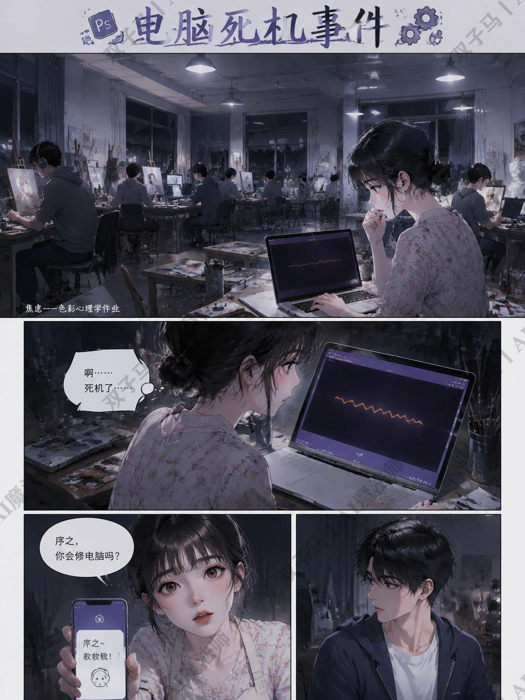

**第 2 页 · 微信分屏（左右两格）**

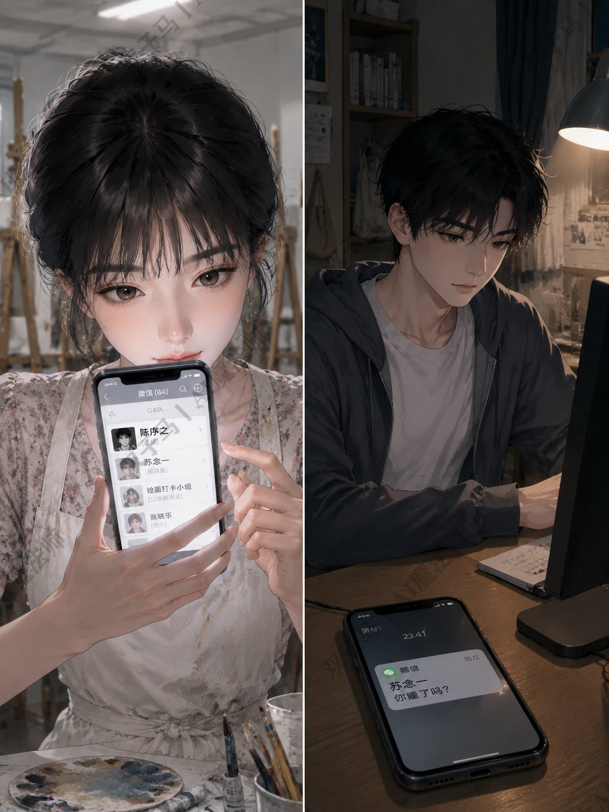

**第 3 页 · 手机聊天记录（整页竖屏格）**

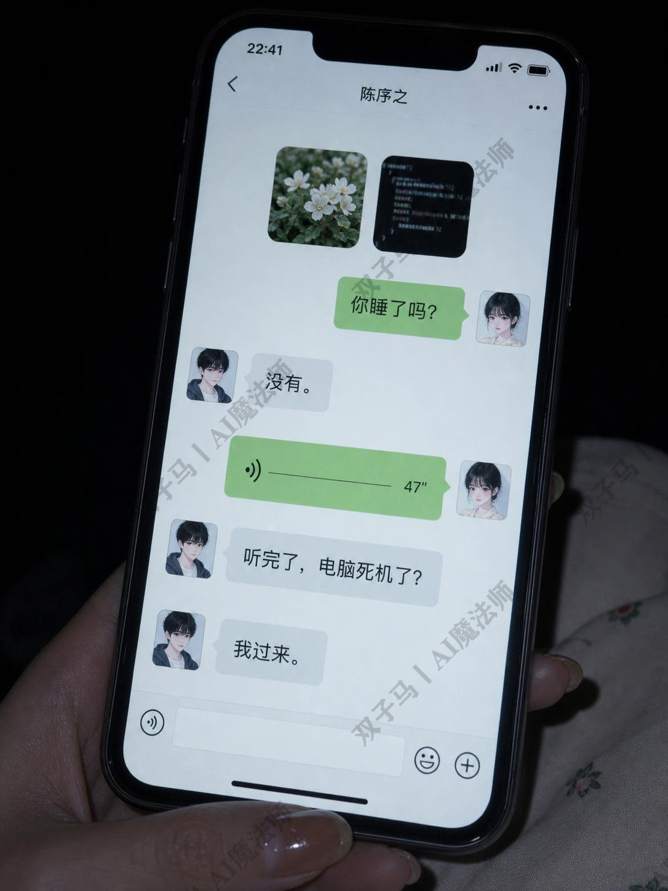

**第 4 页 · 上门救援（上二下一）**

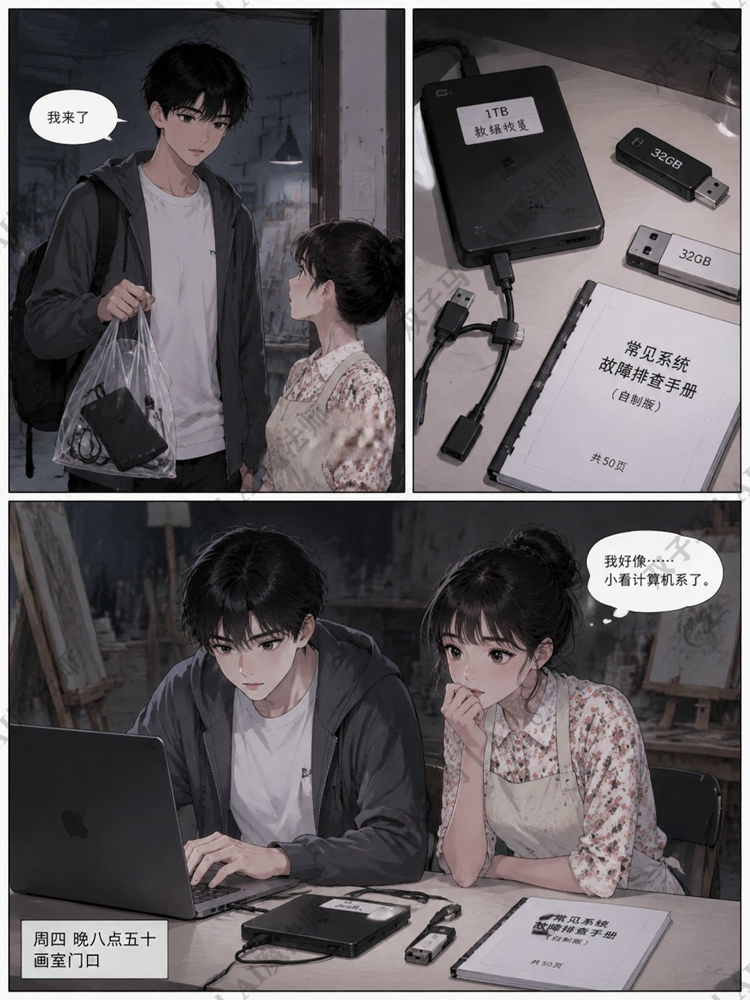

**第 5 页 · 终端修复 + 双人特写（四格网格）**

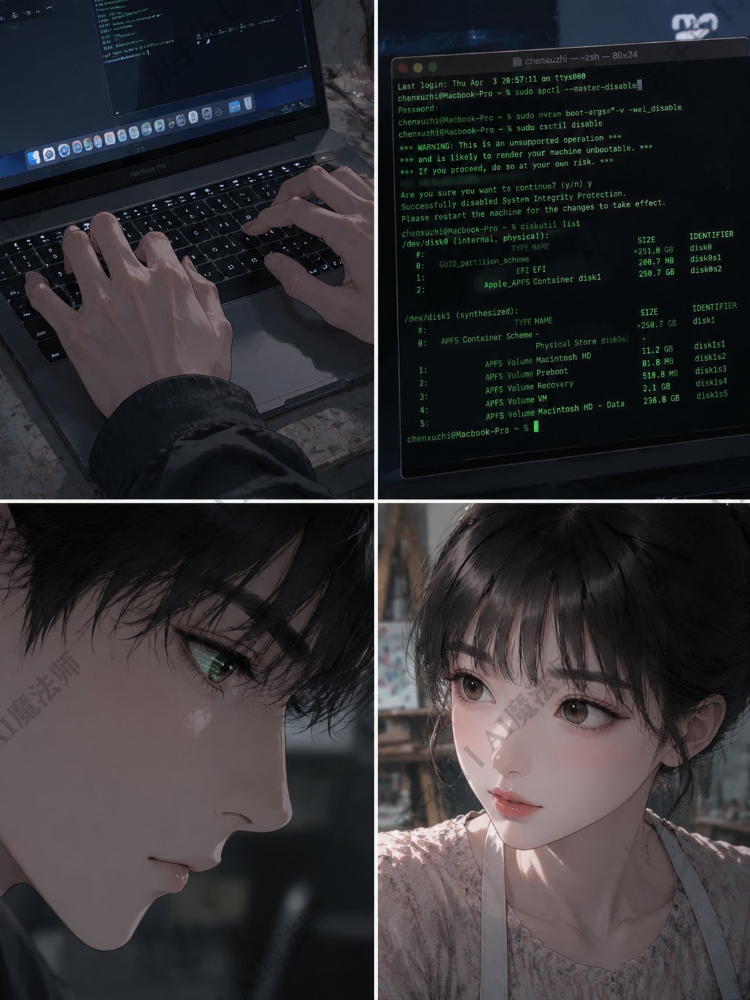

**第 6 页 · 心理戏拉扯（大格对视）**

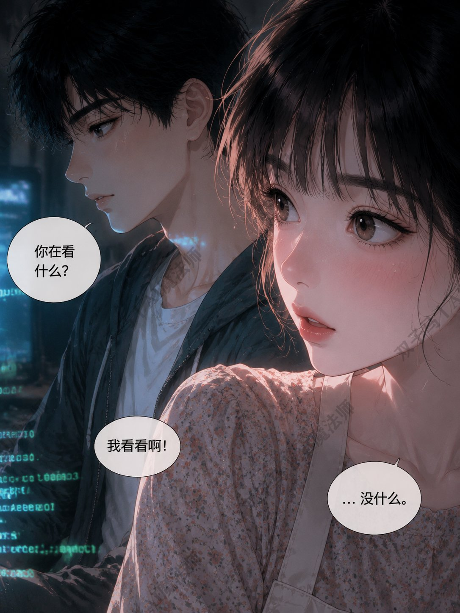

**第 7 页 · 桌面吐槽（屏幕 + 双人反应）**

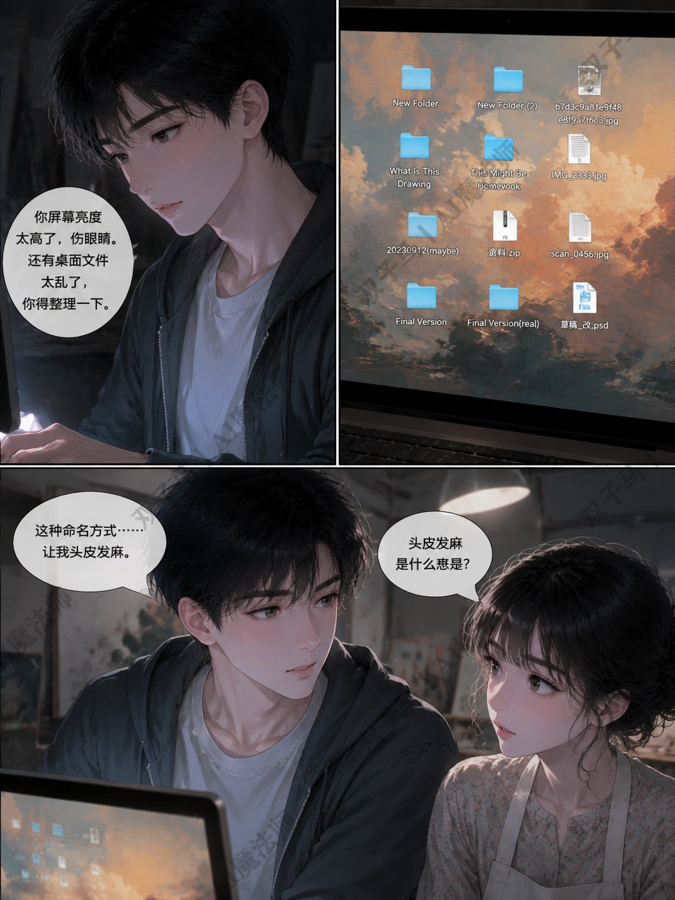

**第 8 页 · 左右斗嘴分屏**

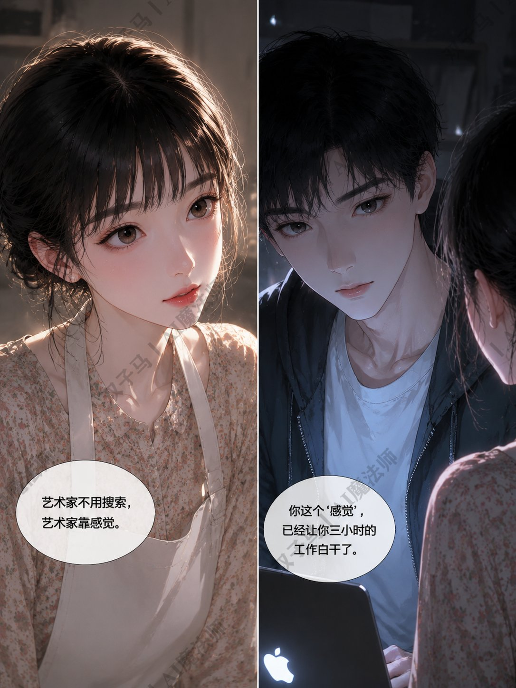

**第 9 页 · 靠近讲解（双人同框）**

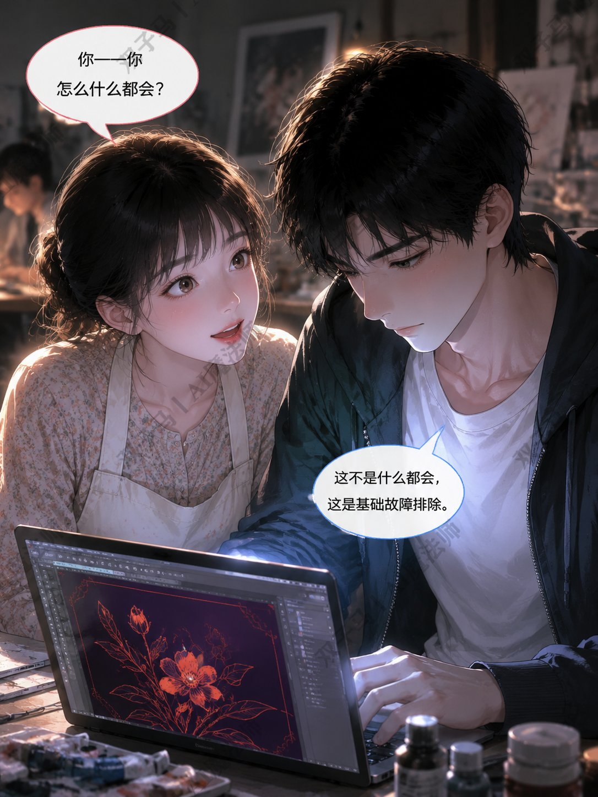

**第 10 页 · 文件夹系统展示**

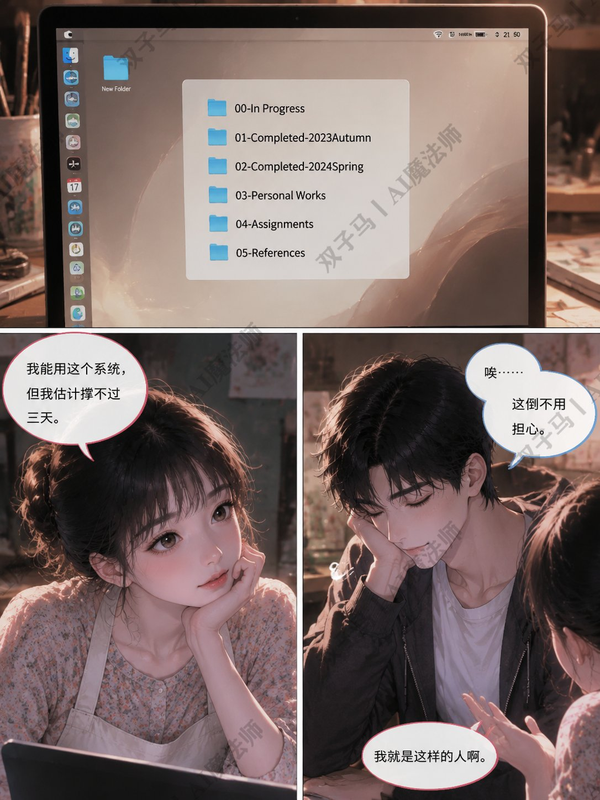

**第 11 页 · U盘交接（左右两格）**

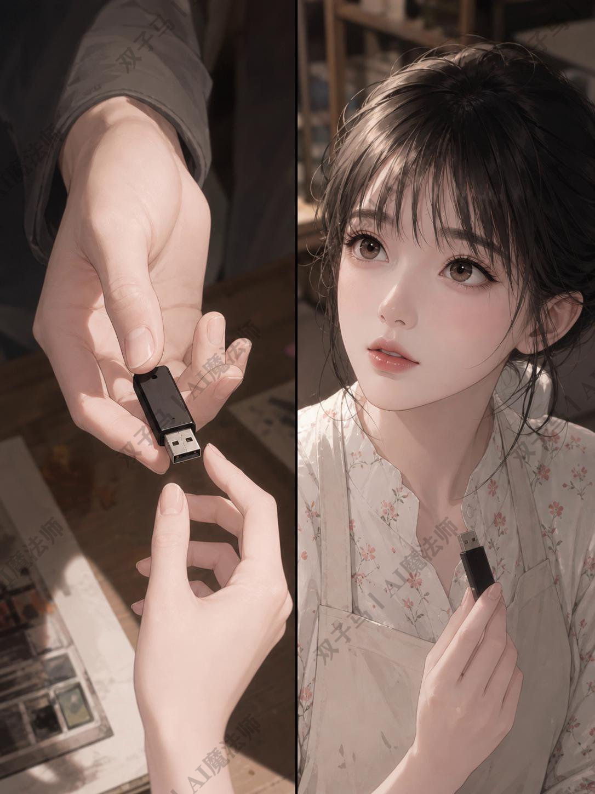

**第 12 页 · 心动瞬间（大格 + 时间标注）**

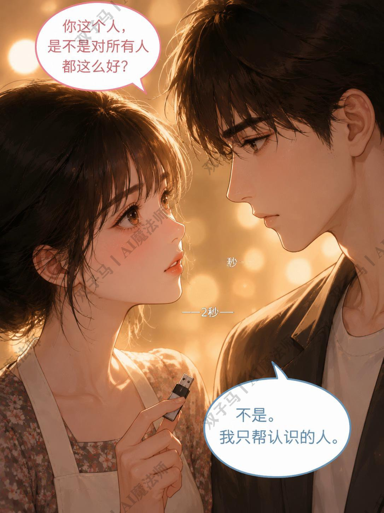

**第 13 页 · 收尾 + 下集预告（通栏）**

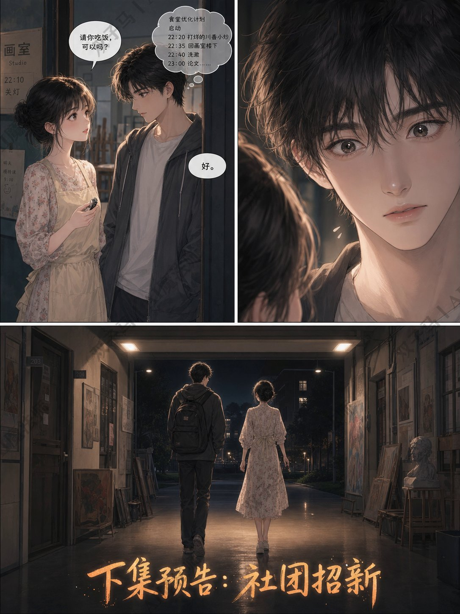

---

## 🤖 适用平台

本技能为 **WorkBuddy SKILL 格式**，开箱即用：

- ✅ **WorkBuddy**（官方支持，技能市场一键装）
- ✅ **OpenClaw** 等智能体平台（兼容 SKILL 规范，直接加载即可）

> 只要是支持 SKILL / 智能体技能规范的平台，都能跑起来。

---

## 📜 原创声明

本技能由 **夜秣** 原创。最初首发于 SkillHub 技能市场，现同步开源于此 GitHub 仓库，供大家学习、改造、二次创作。

以下部分均为夜秣原创整理，非搬运：

- 双层版式体系（7 骨架 + 68 版式 + 5 节奏档位 + 防疲劳三条硬约束）
- 274 种手绘 / IP 画风库（A–H 八组编号体系）
- 角色双版模式（正式版 + 独白 Q 版 + 三种插入法）
- 图字分离工线（组版引擎、气泡约束校验、跳读检测算法）
- 一致性硬档（脸三特征、动作三时态、场次三层状态）
- 八项质检卡与两段式盲读流程
- 左右对照看板（单文件零依赖实现）

---

## 🚀 快速开始

**方式一：SkillHub 一键装（推荐）**

在 WorkBuddy 的 SkillHub 技能市场搜索 `yemo-comic-generator`，或直接从市场安装。

**方式二：GitHub 克隆**

```bash
git clone https://github.com/mcm369568095-hash/yemo-comic-generator.git
# 把文件夹放进 WorkBuddy 的 skills 目录即可加载
```

**怎么用：** 把一段小说章节贴给 WorkBuddy，说「用夜秣漫画生成器把它做成漫画分镜」，它会先问你要哪种节奏档位，然后逐页产出可直接出图的提示词。

要成品页就说「做成成品页，字要准」，走图字分离；要对照视图就说「给我一份对照看板」。

> 组版脚本需要 Python 3 + Pillow（`pip install pillow`）。字体默认找微软雅黑，macOS / Linux 会自动回退到系统黑体。

---

## 📷 关注公众号「夜秣AI搞钱」

更多 AI 创作实战、技能上架玩法，扫码关注：


---

## 📁 仓库结构

```
yemo-comic-generator/
├── SKILL.md                  # 技能主文件（双层版式 + 角色双版 + 双交付模式 + 十步流程）
├── references/
│   ├── 分镜版式库.md         # 68 种分镜版式完整清单与英文提示词
│   ├── 画风风格库.md         # 274 种手绘风格完整编号画廊（A–H）
│   ├── 一致性硬档.md         # 脸三特征 / 参考图角色声明 / 动作三时态 / 场次分层
│   ├── 读序与气泡规则.md     # 两段式盲读 / 11 条核对面 / 气泡五条硬规则 / 跳读检测
│   ├── 八项质检卡.md         # 八个维度 / 三个倍率 / pass-fail-na 规则 / 修正顺序
│   └── 图字分离工作流.md     # 出干净画面 → 写气泡表 → 脚本组版 → 看报告
├── scripts/
│   ├── lettering.py          # 文字组版引擎（Pillow，中文换行/避头尾/气泡/尾巴/校验）
│   └── build_board.py        # 对照看板生成器（单文件 HTML，左提示词右成图）
├── templates/
│   └── 对比看板.html         # 看板模板（零依赖，可打印）
├── assets/
│   ├── wechat-qr.jpg         # 公众号二维码
│   ├── wechat-search.jpg     # 微信搜一搜图
│   ├── styles/               # 八大组风格样图（AI 生成示例）
│   └── example/              # 成品漫画页示例 01-13（《你的公式我的画》「电脑死机事件」整章，按序排列）
└── LICENSE                   # MIT
```

> 本仓库为开源展示版（README + 完整技能文件）。商业化版本与更多模板，详见 SkillHub 市场。
